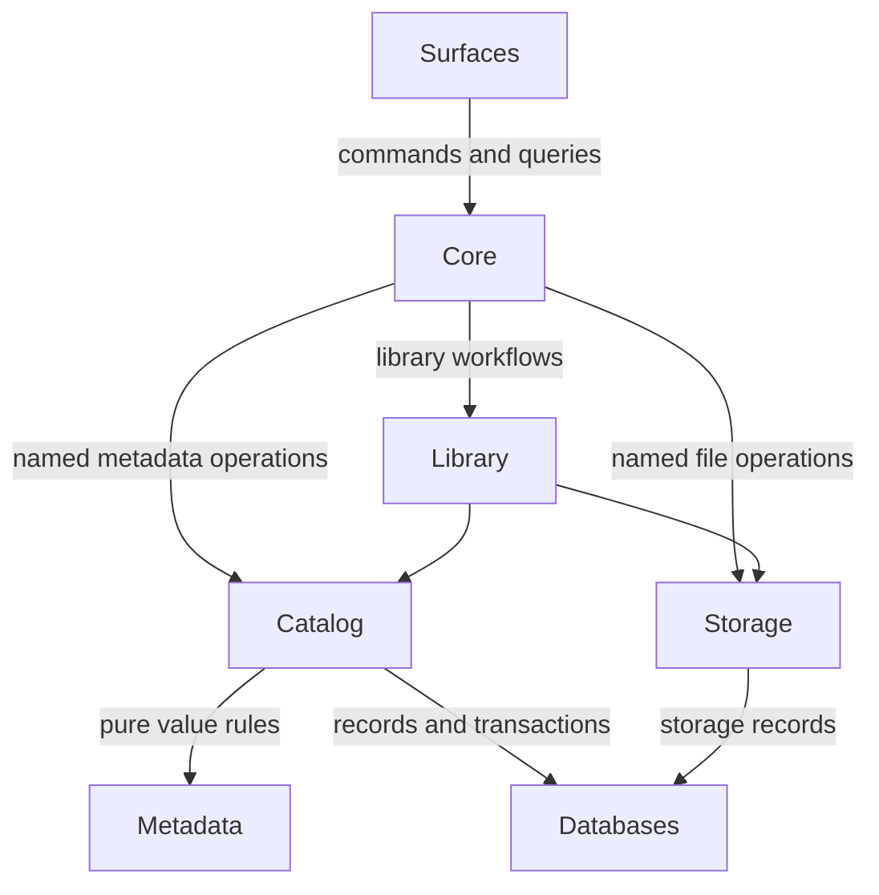

# Top-level structure

Reviewed: **2026-10-19**, against source at `6508d5e0` on
`architecture-review-followup`.

Status: **Current architecture overview, with remaining migrations identified.**
The reviewed source includes the writes, category-read and configuration ownership
changes prepared for integration in PRs #122/#123. A checkout on an earlier branch
may not contain those changes yet. This guide describes that implementation
checkpoint, not a claim that every boundary is complete or already on `main`.

Use this page to understand the major parts and find the owner of a change.
The [separation-of-concerns guide][responsibilities] defines the policy for new
code; subsystem contracts provide the detailed rules and API examples. The
[structural review][structural-review] records the documentation reorganisation
and remaining architectural work.

## The two persistent domains

LiuXin manages bibliographic records and physical files. They meet in library
workflows while retaining separate owners.

Bibliographic records describe Works, Expressions, Manifestations, Items, Agents,
titles, identifiers and their relationships. `metadata` supplies their value
types and meaning; `catalog` applies those meanings to persistent records.
`databases` supplies the underlying rows, constraints and transactions.

Physical storage describes assets, stores, locations and replicas. `storage`
manages their bytes, availability, integrity and placement. Linking an Item to an
asset connects the two domains; a bibliographic identity, a file's content and a
particular stored copy are different things. Copying bytes to another store does
not, by itself, create a new Work or decide which bibliographic record they match.

`library` coordinates work spanning Catalog and storage. `core` composes the
application, owns the resources it creates, and exposes operations to `surfaces`.
Surfaces are the tools people and external programs use to interact with LiuXin.

## How the parts fit together

This diagram shows the principal application relationships. It is not a complete
runtime call graph or a blanket permission to import any reachable package.



Core is the normal application entry point. Reusable in-process consumers can
also use the documented Catalog and storage APIs directly, with explicit resource
ownership. New surface operations should use the named Core command/query
contract, rather than assemble their own database, cache and storage graph.

Caches, ingest, jobs and plugin providers support these relationships. They do not
gain ownership of bibliographic policy merely because they read, discover, schedule
or transform the data. The [layer-direction rules][layer-rules] and
[import-footprint checks][import-checks] enforce specific boundaries and record
remaining exceptions; the diagram does not imply that all old crossings are gone.

## Package responsibilities

Paths below are relative to `src/LiuXin_alpha/`. The table is a quick index;
each package's section explains its role and points to its detailed contracts.

| Package | Summary |
| --- | --- |
| [core](#core) | Application composition, lifecycle and public operations. |
| [library](#library) | Workflows combining bibliographic records and files. |
| [catalog](#catalog) | Metadata-aware persistence, identity and retrieval. |
| [metadata](#metadata) | Metadata values, rules, codecs and providers. |
| [databases](#databases) | Connections, schema, SQL and transactions. |
| [storage](#storage) | Bytes, stores, replicas and recovery. |
| [caches](#caches) | Derived reads and change reconciliation. |
| [surfaces](#surfaces) | Interfaces for people and external programs. |
| [ingest](#ingest) | Discovery, extraction and acquisition pipelines. |
| [jobs](#jobs) | Durable task records and execution contracts. |
| [file_formats](#file_formats) | File formats, containers and conversion. |
| [plugin_system](#plugin_system) | Shared plugin contracts and loading mechanics. |
| [customize](#customize) | Application plugin selection and composition. |
| [utils](#utils) | Shared primitives and vendored helpers. |
| [constants](#constants) | Application constants and compatibility values. |
| [resources](#resources) | Installed runtime assets and resource lookup. |
| [startup_scripts](#startup_scripts) | Retained legacy startup integration. |

Package-root docstrings are signposts. Import concrete implementations and
contracts from their owning modules; do not expect passive roots such as
`metadata`, `catalog`, `caches` or `storage` to assemble services.

### core

Core is the application boundary: it selects configuration, composes services,
owns the resources it creates and exposes commands and queries. Its application
services dispatch domain work to Catalog, storage and the relevant workflows.

Start with the [Core API][core-api], `core/factory.py`,
`core/library_services.py` and `core/program_services/`. The
[lifecycle section](#composition-and-lifecycle) explains which collaborators Core
owns and which it borrows.

### library

Library brings bibliographic and file operations together. Its supported facade
uses supplied Catalog, database and storage collaborators to coordinate library
workflows; it does not reopen them or replace their domain rules.

The facade lives in `library/library.py`. The unusable `library.legacy` and
`library.backend` modules were retired and are not alternative application APIs.
Keep workflow coordination here while leaving composition with Core, metadata
validity with Catalog and physical operations with storage.

### catalog

Catalog turns persistence into bibliographic operations. It owns repositories,
identity matching, semantic mutations and persistence-aware metadata retrieval.
A domain operation can span several tables without exposing that storage layout
to its caller.

Use the [Catalog API guide][catalog-api] for entry points, the
[write contract][write-contract] for validation boundaries and the
[matching policy][matching-policy] for identity decisions. Its internal areas and
their relationship to metadata and caches are explained under
[metadata writes and reads](#metadata-writes-and-reads).

### metadata

Metadata defines values, containers, WEMI vocabulary, pure normalization and
validation, codecs and file metadata providers. It supplies the meaning that
Catalog applies to persistent records. Database/cache-backed hydration belongs
to Catalog rather than to the value containers.

Start with the [container guide][metadata-guide], `metadata/facade.py` for pure
OPF/container transformations, and `metadata/file_sources/` for file metadata
readers and writers. A metadata value object does not own a database transaction.

### databases

Databases owns connections, drivers, SQL execution, schema, structural constraints,
transactions and low-level repair machinery. It persists both bibliographic and
storage records while leaving their domain policy to Catalog and storage.

The main entry points are `databases/database/` and
`databases/database_driver_plugins/`; the [database field guide][database-guide]
provides orientation. Database constraints remain necessary even when application
code has validated a value, particularly for concurrent writes.

### storage

Storage manages bytes, assets, replicas, stores and physical placement. It performs
verification, backup execution and recovery through backend contracts, and records
the resulting storage state through the database layer.

See the [storage index][storage-guide] and [storage API][storage-api]. Bibliographic
identity remains with Catalog. Cross-domain workflows coordinate the two; storage
does not decide which Work an imported file represents. Remaining deletion and
recovery-policy boundaries are described below.

### caches

Caches supplies derived rows, relationships, indexes and read acceleration. A
backend may serve loaded snapshots or live reads according to its capabilities.
Reconciliation-aware write conveniences delegate semantic changes to Catalog.

The [Catalog/cache contract][cache-contract] defines read, write and invalidation
behaviour. Cache contents are derived state, not another authority for identity
or validation. Direct persistence changes do not automatically refresh every
independent cache instance.

### surfaces

Surfaces contains CLI, terminal, GUI and web adapters. It translates external
input into application requests and turns results into presentation, progress
updates or delivery responses. Domain rules remain behind the application API.

Start with [CLI composition][cli-composition] and
[terminal composition][terminal-composition]. New operations should use named
Core commands and queries, keeping interface-specific formatting and interaction
out of Catalog, storage and their workflows.

### ingest

Ingest discovers inputs, extracts candidates and provenance, and runs acquisition
pipelines. A candidate still needs Catalog acceptance; finding or parsing a file
does not make its metadata valid or choose its storage policy.

See [mixed-ingest operations][ingest-guide] and `ingest/mixed_application.py`.
Mixed ingest consumes an injected Library for application work. Coordinating
acceptance, file operations, cancellation and recovery remains an explicit
workflow responsibility.

### jobs

Jobs provides durable task records and scheduling/worker contracts. A job invokes
the workflow that owns an action; scheduling a mutation does not transfer metadata
validation or storage placement policy to the job system.

Start with `jobs/api.py`, `jobs/repository.py` and the long-running-operation
contract in the [Core API][core-api]. Core execution services and `utils.jobs`
primitives still have distinct lifecycles; their consolidation remains work to do.

### file_formats

File formats owns format implementations, container handling, conversion contracts
and profiles, and the native runtime for standalone format plugins. Reusable
format code must not depend on application registry assembly or database-backed
library composition.

The [format index][format-guide] leads to individual format dossiers. Shared
conversion code lives in `file_formats/conversion/`, and standalone plugin
composition in `file_formats/plugin_runtime.py`. File metadata providers have
their separate implementation home in `metadata.file_sources`.

### plugin_system

Plugin system supplies passive, format-neutral lifecycle, hook and stream
contracts, shared plugin settings and loading mechanics. These are foundations
for different plugin families, not an application provider registry.

Importing its package root does not discover providers or start services. The
[plugin composition guide][plugin-guide] explains how these contracts relate to
format implementations and application composition.

### customize

Customize selects and composes the application provider fleet, retains compatibility
exports and binds initialized instances into the native format runtime. It is a
composition owner above the neutral plugin contracts and format implementations.

See the [plugin composition guide][plugin-guide]. Registry initialization and
provider ordering still need consolidation; contract extraction did not remove
all application-level plugin ownership debt.

### utils

Utils contains shared primitives, vendored libraries and compatibility helpers.
The existing tree also retains some older configuration, execution and domain
responsibilities, so placement here is not evidence that a helper is policy-free.

Use the [responsibility guide][responsibilities] when deciding where shared code
belongs. General mechanics can live in utilities; bibliographic normalization,
application selection and storage policy belong to their named owners even when
several callers need them.

### constants

Constants exposes application identity, platform/file-extension values and
historical compatibility settings. `constants/file_extensions.py` groups extension
sets; `constants/paths.py` retains path-related compatibility and scratch defaults.

Application preference selection belongs to Core and the configuration layer,
as described under [configuration](#configuration). The remaining path defaults
are migration work, not a second configuration model to extend for new features.

### resources

Resources holds packaged runtime assets and resolves them through the installed
package. Its lookup helpers use `importlib.resources` rather than assuming that a
developer checkout exists. Inherited callers needing real paths require an
unpacked installation.

See the [packaging contract][packaging] and `resources/__init__.py`. Other resource
owners, such as the database schema tree, remain with their packages; build
configuration declares which assets ship. Instance data and mutable preferences
do not belong in the installed resource tree.

### startup_scripts

Startup scripts retains legacy initialization for preferences, directory
preparation and file opening. Importing its root still installs a legacy PyQt4
import hook and replaces the `lopen` builtin; it is not a passive utility import.

New application startup belongs to Core's explicit composition path. Existing
startup hooks need caller and side-effect migration before retirement. Their
presence does not establish that modern configuration or resource ownership
should be implemented here.

## Composition and lifecycle

Core owns startup and shutdown for the application resources it creates. The
concrete owner for one open library graph is
[`LibraryServices`][library-services]. It opens the database without implicit
storage/maintenance startup, composes the required collaborators, and supplies
them to Library and Core services. It unwinds partial startup and attempts every
owned closer during teardown, including when an earlier closer fails.

[`create_core`][core-factory] distinguishes construction from borrowing:

| Input | Ownership |
| --- | --- |
| Database path/connection information | Core creates an owned LibraryServices graph and closes its owned resources. |
| Existing database | The database remains caller-owned; resources Core creates around it are owned by that session. |
| Existing Library | The Library remains caller-owned. Core does not implicitly acquire ownership of its entire graph. |
| Explicit cache versus cache selected by type | An injected cache is borrowed; a cache constructed by Core is owned. |
| Default job manager | The process-shared manager is not shut down by default. Closing it requires an explicit ownership choice. |

The current Core runtime hosts one Library facade. Managing several deployments
or library sessions requires separate resolved instances; this is not a promise
of a single runtime coordinating arbitrary libraries or a cross-library transaction.

Resource lifetime and transaction lifetime are different contracts. Closing a
service graph is not evidence that every database context rolls back on error.
Lower-layer path-opening wrappers and maintenance scheduling also retain migration
work. See the [lifecycle review][lifecycle-review] for the opening-path decisions.

### Configuration

In the reviewed implementation, Core selects the deployment/profile and resolves
application settings before opening the local resource graph. `core/settings.py`
owns selection; `ConfigurationPaths` fixes the application and component paths;
the lazy application Preferences view provides one application settings store.
Ordinary application-setting writes go to its INI file. Database preferences and
component configuration namespaces retain their separate purposes.

Surfaces pass the selected settings into Core; a remote client does not redirect
the server's preference files. Managed workers receive the selected configuration,
but that propagation does not consolidate their job lifecycles. The detailed
`configuration-ownership.md` contract accompanies this implementation checkpoint;
older checkouts predating the configuration change will not contain it.

## Metadata writes and reads

### Writes have one semantic owner

The public Catalog boundary is responsible for establishing the validity of a
requested bibliographic mutation. It must not assume that a surface, container,
annotation or earlier workflow already did so. The responsibilities accumulate:

```text
untrusted input
    -> metadata normalization and pure value validation
    -> Catalog operation/relationship validation
    -> persistence adaptation
    -> database transaction and constraints
```

Catalog exposes repository CRUD and specialised mutations,
`catalog.mutations.writer.*`, and the advanced schema-driven
`catalog.create_writer` / `write` / `write_one` APIs. Library, Core and cache
conveniences use those owners. Row-shaped `add`, `ensure`, `apply` and `intralink`
remain compatibility routes; new code should prefer the semantic APIs.

Normalization rules belong to metadata. Stored identity keys follow declared
identity policies, while approximate matching and display/title sorting remain
different operations. Do not reuse whichever string-cleaning function is nearest
when writing a `*_norm` column.

Database types, foreign keys, uniqueness and transactions remain necessary,
including for concurrent writers. Direct SQL, drivers, macros, `catalog.db` and
private `_apply_*` writer-host methods are outside Catalog's semantic guarantee.
The guarantee is bounded by the available validators: it does not establish that
every conceivable field rule has been implemented. Reads must still be able to
inspect historical data; repair is an explicit operation, not a hidden read effect.

The [write contract][write-contract] owns the policy. Use the
[Catalog API guide][catalog-api] for actual call signatures and examples instead
of treating a design sketch as an implemented API.

### Repositories, matching and retrieval do different work

Within Catalog, `repositories/` exposes domain entities and their operations;
`matching/` evaluates identity; `retrieval/` builds bundles, graphs and projections;
`mutations/` coordinates semantic changes; and `write/` implements schema-driven
writers. These are existing areas, not a proposed package skeleton.

A repository presents a domain concept, not just a SQL table. Its operation may
span entity, title, identifier and relationship tables. Matching can consult
several repositories without becoming an implicit write. Retrieval returns
display-neutral metadata; human layout and interface wording belong to surfaces.

Pure OPF/container transformations belong in `metadata.facade`.
Database/cache-backed hydration and persistence-aware overlays belong in
`catalog.retrieval.metadata` and its hydration helpers. Putting a value in a
metadata container does not make persistence a responsibility of that container.

### Core selects the application read source

Core composes a structured read source over the database or configured cache.
Category count, ordering and membership semantics are shared by the application
surfaces; the recent category work does not unify every other read projection.
Surfaces page and render those results rather than calculate competing counts.

Caches accelerate reads and reconcile authoritative changes. They do not define
another bibliographic identity or write policy. Use the composed cache-aware route
where reconciliation is required; a direct Catalog call does not automatically
refresh an unrelated snapshot cache. Database fallback is an explicit adapter
capability, not permission to turn failed required reads into empty results.
See the [cache contract][cache-contract] and [read-failure rules][read-failures].

## Files, acquisition and background work

Storage manages bytes through backend contracts: a disk, network service or archive
can have different capabilities while exposing a defined storage interface.
Checksums, replica placement, backup execution and verification belong here.
Bibliographic matching and merges belong to Catalog. SQL stores the relevant
records without becoming the owner of either domain's policy.

For example, importing an EPUB folder involves several owners:

1. A surface parses the request and invokes an application operation.
2. Ingest discovers inputs and extracts candidates/provenance using the relevant
   format and metadata providers.
3. The application/Library workflow coordinates Catalog acceptance and storage
   operations using its supplied collaborators.
4. Catalog validates and persists bibliographic changes; storage records and
   performs the required physical operations. Jobs report execution progress and
   results when the operation runs in the background.

This is a responsibility sequence, not a promise that a database transaction can
atomically undo a remote upload or every filesystem change. Recovery, cancellation
and failure reporting need explicit workflow contracts. Mixed ingest now consumes
an injected Library rather than owning a competing durable-service graph.

Jobs invoke domain workflows; they do not inherit metadata validity or placement
policy. The durable jobs layer, Core execution services and `utils.jobs` execution
primitives are still distinct. Consolidating state, restart/cancellation behaviour
and ownership across those pieces remains work to do.

Preserving recoverable copies is a storage goal. It must be enforced at the actual
destructive operation boundary. Last-copy/read-only checks and staging-directory
ownership still have identified gaps; a higher-level evacuation safeguard does
not prove that every low-level deletion route is safe.

## Formats and plugin composition

Plugin contracts, plugin implementations and application composition have
different owners:

- `plugin_system` supplies neutral lifecycle, file-hook and stream contracts. Its
  package import does not discover a provider fleet or start application services.
- `file_formats` owns conversion input/output contracts, implementations and a
  native runtime for standalone format use. `metadata.file_sources` owns file
  metadata readers and writers.
- `customize` composes the application fleet and binds initialized instances into
  the format runtime; compatibility exports remain here.

Format implementations must not reach back into Core, Library, persistence or
application registry assembly. The containment work is implemented; application
registry initialization, provider ordering and some acquisition composition still
need consolidation. Keep format behaviour in the [format dossiers][format-guide]
and shared composition rules in the [plugin guide][plugin-guide].

## Where a new change belongs

| Change | Primary owner |
| --- | --- |
| Define a metadata value, vocabulary or pure normalization rule | `metadata` |
| Accept, link, match, merge or retrieve bibliographic records | `catalog`, using metadata rules and database constraints |
| Change connections, schema, SQL or transaction mechanics | `databases` |
| Move, verify, retain or recover bytes and replicas | `storage` |
| Coordinate Catalog and storage in a library operation | The Library/application workflow owner; Core exposes and composes it |
| Change deployment selection, owned resources or public operations | `core` |
| Discover/extract candidates or coordinate durable execution | `ingest` or `jobs`, with the domain action delegated to its owner |
| Add a parser, format converter or provider | The relevant format/metadata implementation, registered by its composition owner |
| Parse interface input, render results or frame delivery | `surfaces` |

Prefer a focused change to the existing owner over a second implementation under
another package. Retained compatibility is migration debt with real callers, not
a model for new code. Conversely, a dynamic or plugin path is not dead merely
because a simple import graph cannot reach it.

The main unresolved boundaries are transport/read-only capabilities, destructive
storage policy, low-level transaction/creation safety, jobs/ingest/registry
ownership and retained compatibility islands. Keep their status explicit when
changing this overview. The [dated structural review][structural-review] supplies
the change trail and priorities; [quality gates][quality-gates] identifies the
enforced scopes, not a claim of universal architectural correctness.

[responsibilities]: <04 - Seperation of Concerns.md>
[structural-review]: architectural_reviews/documentation-structural-review-2026-10-18.md
[layer-rules]: layer-direction-ratchet.md
[import-checks]: import-footprint-ratchet.md
[core-api]: core-api.md
[catalog-api]: catalog-api-usage.md
[write-contract]: catalog-write-validation-contract.md
[matching-policy]: catalog-matching-policy.md
[metadata-guide]: metadata_container/metadata_container_system_guide.md
[database-guide]: LiuXin_database_field_guide.md
[storage-guide]: storage/README.md
[storage-api]: storage/storage_api.md
[cache-contract]: catalog-cache-boundary.md
[cli-composition]: cli-composition.md
[terminal-composition]: terminal-composition.md
[ingest-guide]: storage/mixed_ingest_operations.md
[format-guide]: file-formats/README.md
[plugin-guide]: file-formats/plugin-composition.md
[packaging]: packaging.md
[library-services]: ../src/LiuXin_alpha/core/library_services.py
[core-factory]: ../src/LiuXin_alpha/core/factory.py
[lifecycle-review]: lifecycle-opening-path-review-2026-10-09.md
[read-failures]: read-model-failures.md
[quality-gates]: maintainability-quality-gates.md
