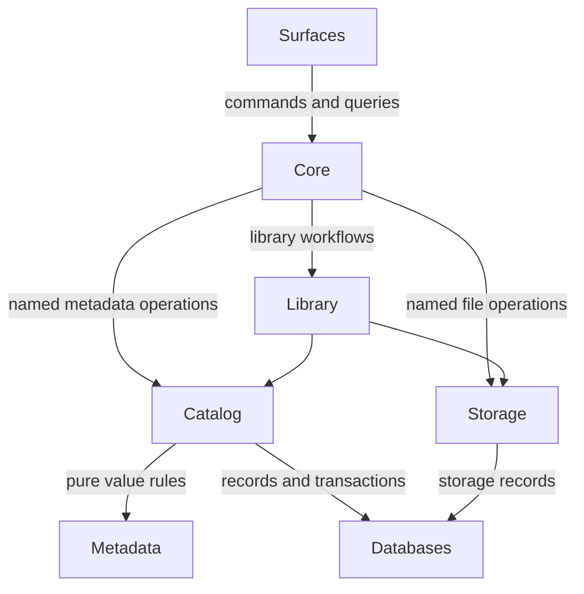

# Top-level structure

Reviewed: **2026-10-19**, against source at `6508d5e0` on
`architecture-review-followup`.

Status: **Current architecture overview, with remaining migrations identified.**
The reviewed source includes the writes, category-read and configuration ownership
changes prepared for integration in PRs #122/#123. A checkout on an earlier branch
may not contain those changes yet. This guide describes that implementation
checkpoint, not a claim that every boundary is complete or already on `main`.

Use this page to understand the major parts and find the owner of a change.
The [separation-of-concerns guide][responsibilities] defines the policy for new
code; subsystem contracts provide the detailed rules and API examples. The
[structural review][structural-review] records the documentation reorganisation
and remaining architectural work.

## The two persistent domains

LiuXin manages bibliographic records and physical files. They meet in library
workflows while retaining separate owners.

Bibliographic records describe Works, Expressions, Manifestations, Items, Agents,
titles, identifiers and their relationships. `metadata` supplies their value
types and meaning; `catalog` applies those meanings to persistent records.
`databases` supplies the underlying rows, constraints and transactions.

Physical storage describes assets, stores, locations and replicas. `storage`
manages their bytes, availability, integrity and placement. Linking an Item to an
asset connects the two domains; a bibliographic identity, a file's content and a
particular stored copy are different things. Copying bytes to another store does
not, by itself, create a new Work or decide which bibliographic record they match.

`library` coordinates work spanning Catalog and storage. `core` composes the
application, owns the resources it creates, and exposes operations to `surfaces`.
Surfaces are the tools people and external programs use to interact with LiuXin.

## How the parts fit together

This diagram shows the principal application relationships. It is not a complete
runtime call graph or a blanket permission to import any reachable package.



Core is the normal application entry point. Reusable in-process consumers can
also use the documented Catalog and storage APIs directly, with explicit resource
ownership. New surface operations should use the named Core command/query
contract, rather than assemble their own database, cache and storage graph.

Caches, ingest, jobs and plugin providers support these relationships. They do not
gain ownership of bibliographic policy merely because they read, discover, schedule
or transform the data. The [layer-direction rules][layer-rules] and
[import-footprint checks][import-checks] enforce specific boundaries and record
remaining exceptions; the diagram does not imply that all old crossings are gone.

## Package responsibilities

All paths in this table are relative to `src/LiuXin_alpha/`.

| Package | Responsibility | Where to look next |
| --- | --- | --- |
| `core` | Application configuration, resource composition, process services and the public command/query contract. Its application services dispatch work to the responsible subsystem. | [Core API][core-api]; `core/factory.py`, `core/library_services.py`, `core/program_services/`. |
| `library` | The supported Library facade and workflows combining bibliographic and file operations. It uses supplied collaborators instead of reopening them. | `library/library.py`; the lifecycle section below. |
| `catalog` | Bibliographic identity, repositories, matching, semantic mutations and persistence-aware metadata retrieval. | [Catalog usage][catalog-api], [write contract][write-contract], [matching policy][matching-policy]. |
| `metadata` | Metadata values, WEMI vocabulary, pure normalization/validation, codecs and file metadata providers. Persistence-aware hydration belongs to Catalog. | [Container guide][metadata-guide]; `metadata/facade.py`, `metadata/file_sources/`. |
| `databases` | Connections, drivers, SQL, schema, structural constraints, transactions and low-level repair machinery. | [Database field guide][database-guide]; `databases/database/` and `databases/database_driver_plugins/`. |
| `storage` | Bytes, assets, replicas, stores, physical placement, verification, backup execution and recovery. | [Storage index][storage-guide] and [API][storage-api]. |
| `caches` | Derived rows, relationships, indexes and read acceleration; reconciliation-aware write conveniences delegate to Catalog. | [Catalog/cache contract][cache-contract]. |
| `surfaces` | CLI, terminal, GUI and web adapters: input parsing, presentation, progress and delivery framing. | [CLI composition][cli-composition], [terminal composition][terminal-composition]. |
| `ingest` | Discovery, extraction, candidates, provenance and acquisition pipelines. Application workflows coordinate acceptance and storage. | [Mixed-ingest operations][ingest-guide]; `ingest/mixed_application.py`. |
| `jobs` | Durable task records and scheduling/execution contracts. Domain work remains with its workflow owner. | `jobs/api.py`, `jobs/repository.py`; Core's long-running-operation contract. |
| `file_formats` | Format implementations, container handling, conversion contracts/profiles and the standalone format-plugin runtime. | [Format index][format-guide]; `file_formats/conversion/`, `file_formats/plugin_runtime.py`. |
| `plugin_system` | Passive, format-neutral lifecycle, hook/stream contracts, shared plugin settings and loading mechanics. | [Plugin composition][plugin-guide]; `plugin_system/`. |
| `customize` | Application provider-fleet composition and retained compatibility exports. | [Plugin composition][plugin-guide]; `customize/`. |
| `utils`, `constants`, `resources`, `startup_scripts` | Shared primitives, vendored helpers, constants, packaged resources and startup integration. Some legacy policy remains here as migration debt. | [Packaging][packaging]; the responsibility guide before adding new domain behaviour to a utility module. |

Package-root docstrings are signposts. Import concrete implementations and
contracts from their owning modules; do not expect passive roots such as
`metadata`, `catalog`, `caches` or `storage` to assemble services. The supported
`Library` facade remains; the unusable `library.legacy` and `library.backend`
modules were retired and are not alternative application APIs.

## Composition and lifecycle

Core owns startup and shutdown for the application resources it creates. The
concrete owner for one open library graph is
[`LibraryServices`][library-services]. It opens the database without implicit
storage/maintenance startup, composes the required collaborators, and supplies
them to Library and Core services. It unwinds partial startup and attempts every
owned closer during teardown, including when an earlier closer fails.

[`create_core`][core-factory] distinguishes construction from borrowing:

| Input | Ownership |
| --- | --- |
| Database path/connection information | Core creates an owned LibraryServices graph and closes its owned resources. |
| Existing database | The database remains caller-owned; resources Core creates around it are owned by that session. |
| Existing Library | The Library remains caller-owned. Core does not implicitly acquire ownership of its entire graph. |
| Explicit cache versus cache selected by type | An injected cache is borrowed; a cache constructed by Core is owned. |
| Default job manager | The process-shared manager is not shut down by default. Closing it requires an explicit ownership choice. |

The current Core runtime hosts one Library facade. Managing several deployments
or library sessions requires separate resolved instances; this is not a promise
of a single runtime coordinating arbitrary libraries or a cross-library transaction.

Resource lifetime and transaction lifetime are different contracts. Closing a
service graph is not evidence that every database context rolls back on error.
Lower-layer path-opening wrappers and maintenance scheduling also retain migration
work. See the [lifecycle review][lifecycle-review] for the opening-path decisions.

### Configuration

In the reviewed implementation, Core selects the deployment/profile and resolves
application settings before opening the local resource graph. `core/settings.py`
owns selection; `ConfigurationPaths` fixes the application and component paths;
the lazy application Preferences view provides one application settings store.
Ordinary application-setting writes go to its INI file. Database preferences and
component configuration namespaces retain their separate purposes.

Surfaces pass the selected settings into Core; a remote client does not redirect
the server's preference files. Managed workers receive the selected configuration,
but that propagation does not consolidate their job lifecycles. The detailed
`configuration-ownership.md` contract accompanies this implementation checkpoint;
older checkouts predating the configuration change will not contain it.

## Metadata writes and reads

### Writes have one semantic owner

The public Catalog boundary is responsible for establishing the validity of a
requested bibliographic mutation. It must not assume that a surface, container,
annotation or earlier workflow already did so. The responsibilities accumulate:

```text
untrusted input
    -> metadata normalization and pure value validation
    -> Catalog operation/relationship validation
    -> persistence adaptation
    -> database transaction and constraints
```

Catalog exposes repository CRUD and specialised mutations,
`catalog.mutations.writer.*`, and the advanced schema-driven
`catalog.create_writer` / `write` / `write_one` APIs. Library, Core and cache
conveniences use those owners. Row-shaped `add`, `ensure`, `apply` and `intralink`
remain compatibility routes; new code should prefer the semantic APIs.

Normalization rules belong to metadata. Stored identity keys follow declared
identity policies, while approximate matching and display/title sorting remain
different operations. Do not reuse whichever string-cleaning function is nearest
when writing a `*_norm` column.

Database types, foreign keys, uniqueness and transactions remain necessary,
including for concurrent writers. Direct SQL, drivers, macros, `catalog.db` and
private `_apply_*` writer-host methods are outside Catalog's semantic guarantee.
The guarantee is bounded by the available validators: it does not establish that
every conceivable field rule has been implemented. Reads must still be able to
inspect historical data; repair is an explicit operation, not a hidden read effect.

The [write contract][write-contract] owns the policy. Use the
[Catalog API guide][catalog-api] for actual call signatures and examples instead
of treating a design sketch as an implemented API.

### Repositories, matching and retrieval do different work

Within Catalog, `repositories/` exposes domain entities and their operations;
`matching/` evaluates identity; `retrieval/` builds bundles, graphs and projections;
`mutations/` coordinates semantic changes; and `write/` implements schema-driven
writers. These are existing areas, not a proposed package skeleton.

A repository presents a domain concept, not just a SQL table. Its operation may
span entity, title, identifier and relationship tables. Matching can consult
several repositories without becoming an implicit write. Retrieval returns
display-neutral metadata; human layout and interface wording belong to surfaces.

Pure OPF/container transformations belong in `metadata.facade`.
Database/cache-backed hydration and persistence-aware overlays belong in
`catalog.retrieval.metadata` and its hydration helpers. Putting a value in a
metadata container does not make persistence a responsibility of that container.

### Core selects the application read source

Core composes a structured read source over the database or configured cache.
Category count, ordering and membership semantics are shared by the application
surfaces; the recent category work does not unify every other read projection.
Surfaces page and render those results rather than calculate competing counts.

Caches accelerate reads and reconcile authoritative changes. They do not define
another bibliographic identity or write policy. Use the composed cache-aware route
where reconciliation is required; a direct Catalog call does not automatically
refresh an unrelated snapshot cache. Database fallback is an explicit adapter
capability, not permission to turn failed required reads into empty results.
See the [cache contract][cache-contract] and [read-failure rules][read-failures].

## Files, acquisition and background work

Storage manages bytes through backend contracts: a disk, network service or archive
can have different capabilities while exposing a defined storage interface.
Checksums, replica placement, backup execution and verification belong here.
Bibliographic matching and merges belong to Catalog. SQL stores the relevant
records without becoming the owner of either domain's policy.

For example, importing an EPUB folder involves several owners:

1. A surface parses the request and invokes an application operation.
2. Ingest discovers inputs and extracts candidates/provenance using the relevant
   format and metadata providers.
3. The application/Library workflow coordinates Catalog acceptance and storage
   operations using its supplied collaborators.
4. Catalog validates and persists bibliographic changes; storage records and
   performs the required physical operations. Jobs report execution progress and
   results when the operation runs in the background.

This is a responsibility sequence, not a promise that a database transaction can
atomically undo a remote upload or every filesystem change. Recovery, cancellation
and failure reporting need explicit workflow contracts. Mixed ingest now consumes
an injected Library rather than owning a competing durable-service graph.

Jobs invoke domain workflows; they do not inherit metadata validity or placement
policy. The durable jobs layer, Core execution services and `utils.jobs` execution
primitives are still distinct. Consolidating state, restart/cancellation behaviour
and ownership across those pieces remains work to do.

Preserving recoverable copies is a storage goal. It must be enforced at the actual
destructive operation boundary. Last-copy/read-only checks and staging-directory
ownership still have identified gaps; a higher-level evacuation safeguard does
not prove that every low-level deletion route is safe.

## Formats and plugin composition

Plugin contracts, plugin implementations and application composition have
different owners:

- `plugin_system` supplies neutral lifecycle, file-hook and stream contracts. Its
  package import does not discover a provider fleet or start application services.
- `file_formats` owns conversion input/output contracts, implementations and a
  native runtime for standalone format use. `metadata.file_sources` owns file
  metadata readers and writers.
- `customize` composes the application fleet and binds initialized instances into
  the format runtime; compatibility exports remain here.

Format implementations must not reach back into Core, Library, persistence or
application registry assembly. The containment work is implemented; application
registry initialization, provider ordering and some acquisition composition still
need consolidation. Keep format behaviour in the [format dossiers][format-guide]
and shared composition rules in the [plugin guide][plugin-guide].

## Where a new change belongs

| Change | Primary owner |
| --- | --- |
| Define a metadata value, vocabulary or pure normalization rule | `metadata` |
| Accept, link, match, merge or retrieve bibliographic records | `catalog`, using metadata rules and database constraints |
| Change connections, schema, SQL or transaction mechanics | `databases` |
| Move, verify, retain or recover bytes and replicas | `storage` |
| Coordinate Catalog and storage in a library operation | The Library/application workflow owner; Core exposes and composes it |
| Change deployment selection, owned resources or public operations | `core` |
| Discover/extract candidates or coordinate durable execution | `ingest` or `jobs`, with the domain action delegated to its owner |
| Add a parser, format converter or provider | The relevant format/metadata implementation, registered by its composition owner |
| Parse interface input, render results or frame delivery | `surfaces` |

Prefer a focused change to the existing owner over a second implementation under
another package. Retained compatibility is migration debt with real callers, not
a model for new code. Conversely, a dynamic or plugin path is not dead merely
because a simple import graph cannot reach it.

The main unresolved boundaries are transport/read-only capabilities, destructive
storage policy, low-level transaction/creation safety, jobs/ingest/registry
ownership and retained compatibility islands. Keep their status explicit when
changing this overview. The [dated structural review][structural-review] supplies
the change trail and priorities; [quality gates][quality-gates] identifies the
enforced scopes, not a claim of universal architectural correctness.

[responsibilities]: <04 - Seperation of Concerns.md>
[structural-review]: architectural_reviews/documentation-structural-review-2026-10-18.md
[layer-rules]: layer-direction-ratchet.md
[import-checks]: import-footprint-ratchet.md
[core-api]: core-api.md
[catalog-api]: catalog-api-usage.md
[write-contract]: catalog-write-validation-contract.md
[matching-policy]: catalog-matching-policy.md
[metadata-guide]: metadata_container/metadata_container_system_guide.md
[database-guide]: LiuXin_database_field_guide.md
[storage-guide]: storage/README.md
[storage-api]: storage/storage_api.md
[cache-contract]: catalog-cache-boundary.md
[cli-composition]: cli-composition.md
[terminal-composition]: terminal-composition.md
[ingest-guide]: storage/mixed_ingest_operations.md
[format-guide]: file-formats/README.md
[plugin-guide]: file-formats/plugin-composition.md
[packaging]: packaging.md
[library-services]: ../src/LiuXin_alpha/core/library_services.py
[core-factory]: ../src/LiuXin_alpha/core/factory.py
[lifecycle-review]: lifecycle-opening-path-review-2026-10-09.md
[read-failures]: read-model-failures.md
[quality-gates]: maintainability-quality-gates.md
