# Database schema

Reviewed: **2026-10-19**, against `15080c6e` and a fresh build from the packaged
FRBR SQLite generator.

Status: **Current schema overview; backend and migration limits are explicit.**

The schema separates bibliographic identity from physical storage. Work,
Expression, Manifestation and Item records describe what a library holds.
Digital assets describe payloads; replicas describe copies on particular stores.
Catalog owns bibliographic operations, storage owns physical operations, and
databases supplies persistence and structural constraints. See the
[ownership guide](<04 - Seperation of Concerns.md>) for those boundaries.

This page describes the generated schema, not every column or every backend.
The packaged SQL, TOML declarations and backend builders are the authority for
physical tables and constraints. Historical database files may have different
columns; opening one does not imply that every current schema change was applied.

## Where the schema is defined

The [FRBR generator][generator] builds an empty SQLite database in stages:

| Input | Responsibility |
| --- | --- |
| [Table SQL][table-sql] | Explicit entity, storage, policy, workflow and database-metadata tables. |
| [Interlink declarations][interlinks] | Relations between table families, cardinality, optional relation columns and allowed roles. |
| [Intralink declarations][intralinks] | Relations within an entity family, including typed and symmetric relations. |
| [Trigger SQL][trigger-sql] | Additional structural, timestamp, storage and workflow guards. |
| [Aggregate configuration][aggregates] and [view SQL][views] | Enabled read projections and compatibility views. |
| [Column policies][column-policy-source] and [identity declarations][identity-source] | Seeded per-column policy and derived row-identity contracts. |

The builder also seeds reference data such as languages. It commits between
stages: a full build is not an atomic schema migration and must not be used as
an upgrade routine on an existing library.

PostgreSQL has its own [schema builder][postgres-schema] and
[Catalog relationship generator][postgres-links], which reuse supported shared
declarations. The SQLite views, triggers and complete object inventory below do
not establish PostgreSQL parity. Use the [PostgreSQL runbook](databases/postgresql-backend.md)
and backend contract tests for that deployment.

## The bibliographic graph

| Table | Meaning | Typical facts |
| --- | --- | --- |
| `works` | An intellectual or artistic creation | Canonical title, original context, broad classification. |
| `expressions` | A realization of a Work | Translation, revision, narration, language and mode. |
| `manifestations` | A publication or product embodiment | Edition, format, publication date and stable product characteristics. |
| `items` | An individual owned or observed copy | Acquisition, inventory, condition, source and lifecycle. |

For example, a novel is a Work; an English text and an audiobook narration can
be different Expressions; an EPUB edition and an audiobook release can be
Manifestations; a particular acquired copy is an Item.

```mermaid
flowchart LR
    W[works] -->|expression_work_links: many to many| E[expressions]
    E -->|expression_manifestation_links: many to many| M[manifestations]
    M -->|items.item_manifestation_id| I[items]
    I -->|digital_asset_item_links| A[digital_assets]
    I -->|composite_digital_asset_item_links| C[composite_digital_assets]
    C -->|ordered member links| A
    A -->|asset_replicas.asset_replica_digital_asset_id| R[asset_replicas]
    R -->|asset_replica_store_id| S[stores]
```



Arrows show navigation between records, not Python dependencies or an operation's
transaction boundary.

### Work, Expression and Manifestation links

`expression_work_links` and `expression_manifestation_links` are many-to-many.
An Expression can participate in more than one Work, and a Manifestation can
embody several Expressions. These relations support compilations, shared
realizations and multi-expression editions; the schema is not a strict tree.

Both link tables carry `priority`, `primary` and `origin` fields, along with the
standard source/timestamp/scratch fields. A `primary` marker supports selection
of a preferred path; its presence does not turn the relation into a one-to-one
foreign key.

`items.item_manifestation_id` is a direct foreign key, so an Item has at most
one Manifestation. It is nullable to support staged/blank-row construction.
A structurally insertable placeholder is not necessarily a complete Catalog
record. Catalog workflows establish the required bibliographic relationships.

The [worked link examples](databases/wemi-link-examples.md) show the actual rows
for translations, bilingual editions, a novel with a separate introduction,
omnibuses, shared Expressions, primary selection and individual copies. They also
distinguish default-view selection from Catalog bundle retrieval and follow an
Item through its asset and replicas.

### Agents and credits

`agents` represents people, organisations, groups and pseudonyms. Optional
`human_agents` and `org_agents` sidecars hold subtype-specific facts; each populated
sidecar reference is unique to its Agent. `org_agent_relations` holds relationships
between organisation Agents.

Credits connect the Agent to the relevant WEMI level through generated tables such
as `agent_work_links` and `agent_manifestation_links`. The relation's type carries
the role, such as author, translator or publisher; priority orders credits where
supported. Role vocabularies come from the shared metadata contracts. New code
must not reconstruct a separate `creators` or `publishers` entity model from the
old link-table descriptions.

### Identifiers and other metadata

`entity_identifiers` stores curated identifiers with an entity type and entity ID;
`item_identifiers` stores identifiers observed on a particular Item, with their
source. Observed input and curated identity are distinct contracts. Metadata owns
scheme/value rules and Catalog validates semantic writes; SQL checks alone do not
prove that an ISBN, DOI or other value is valid.

Tags, labels, genres, subjects, series, ratings, comments, synopses, notes and
annotations retain separate entity tables. Relations attach them at the declared
levels. The hierarchy fields on genres, subjects and series have their own
contracts; do not assume every pair of metadata tables has a generated link.
See the [Catalog API](catalog/catalog-api-usage.md) for supported operations.

## Digital assets and physical copies

### Atomic assets

`digital_assets` holds atomic payload metadata: names, media information, size,
hashes, source, integrity observations and policy references. An asset does not
contain its one authoritative store path; the same payload can have several
replicas.

`digital_asset_item_links` associates an asset with an Item. Its type records the
attachment role, for example `primary_payload`, `cover`, `metadata_sidecar` or
`derived_output`. The relation can also carry priority, primary selection and
provenance. An asset can have different roles for different Items.

### Composite assets

`composite_digital_assets` is a separate table for multipart assemblies, such as
an audiobook whose chapters are individual audio files. It connects to Items
through `composite_digital_asset_item_links` and to atomic members through
`composite_digital_asset_digital_asset_links`.

Membership carries `sequence_number`, `is_required`, a role/type and provenance.
Replicas refer to the atomic members, not to the composite row. The current schema
does not use a `digital_asset_kind` discriminator or a `digital_asset_compositions`
table; those belong to an earlier design.

Composition says which assets form an assembly. Derivation says that one asset
was produced from another. `digital_asset_derivations`, `transform_runs`,
`transform_run_inputs` and `transform_run_outputs` retain execution/lineage data.
Their presence does not establish a complete reproducible-build record; the
[storage design](storage_and_backup/design-patterns.md) describes the broader
contract and remaining adapter/migration work.

### Replicas, stores and folders

`asset_replicas` connects an atomic asset to a store and a store-relative key.
It records mode, presence, observed hashes and verification state. The mode is
one of `active`, `backup`, `archive`, `cache`, `transient` or `unmanaged`.

`stores` records backend location/configuration, capabilities, failure domain,
region, tags and default policy references. `folders` is an optional hierarchy
within a store. A replica can name a folder; a populated folder reference must
agree with the replica's store.

The SQLite schema includes a unique `(store, storage_key)` index, guards against
blank keys, URI schemes and leading path separators, and checks that active/backup/archive modes
are supported by the selected store. Several foreign-key fields remain nullable
for staged records. These guards do not replace storage's path containment,
backend capability checks, transfer execution or integrity verification.

### Storage policy and operational state

`replication_policies` and `backup_policies` describe desired copies, placement
constraints and verification/retention inputs. Assets and composites have policy
references; stores and folders have default policy references. Resolving and
applying defaults is storage behaviour, not an inference from foreign keys alone.

Current SQLite copy minima permit zero (`>= 0`), while a supplied target must be
at least its minimum. This does not by itself encode the full retention/loss
semantics of every storage API. Consult the [storage status](storage_and_backup/storage_component_status.md)
and [policy design notes](<databases/04 - Digital assets, replicas and storage policy.md>)
when changing those contracts.

Storage ingest journals, schema-migration records, backup workflow/state/output
tables and item/asset workflow events support recovery and execution tracking.
They do not transfer task scheduling or bibliographic policy into the database.
A table's existence also does not prove that every proposed workflow is implemented.

## How to read a relationship table

Generated interlinks normally use singular endpoint prefixes in a physical name
such as `agent_work_links`. Intralinks connect rows of the same family, for example
`work_work_intralinks`. Their TOML declarations decide cardinality and capabilities;
a name alone does not tell you whether a relation is typed, ordered or exclusive.

| Relation field | Meaning |
| --- | --- |
| Endpoint IDs | The related entity rows. |
| `type` | A semantic role or relation kind, when requested. Typed relations can have a generated `__types` vocabulary table. |
| `priority` | Relation ordering, when requested. It is independent of type. |
| `primary` | Preferred-selection information for declarations that request it. |
| `origin` / `source` | Provenance fields; they do not replace the semantic role. |
| `sequence_number` / `is_required` | Ordered composite membership and required-member information on that relation. |

Not every relation has every column, and cardinality/uniqueness rules vary.
Use schema introspection and [link capabilities](databases/link-capabilities.md)
rather than inventing table/column names. Even a one-to-one relation does not
by itself prove that the destination row is owned and may be deleted with its
source; Catalog writers use explicit ownership metadata.

## Column policy and normalized identity

`column_metadata` describes physical columns: semantic role, comparison,
normalization, empty-value handling, merge policy and presentation hints. A stored
validation-profile name is declarative metadata; Catalog still has to invoke the
validator before a semantic write.

`normalized_identities` declares the subset of values whose derived keys identify
rows, including scope and uniqueness. Current tags, labels, genres, subjects and
series use `unicode_nfkc_whitespace_casefold`: NFKC, case folding and whitespace
collapse, retaining punctuation and all words. Genres and subjects also retain
parent scope. Names such as `tag_phash` are historical column spellings, not a
reason to substitute a different identity algorithm.

Supported write adapters derive those keys from source values, and unique indexes
provide the final collision guard. Approximate matching and display sorting remain
separate policies. Reads do not silently repair historical keys. See
[column metadata](databases/column-metadata.md) and the
[Catalog write contract](catalog/catalog-write-validation-contract.md).

Other administrative tables hold library/database identity, versions, database-local
preferences, custom-column declarations and plugin data. Database-local preferences
are distinct from Core's [application configuration](core/configuration-ownership.md).

## Views and retained compatibility tables

The enabled aggregate SQL creates read projections over the graph:

- `wemi_rays_v`: Work–Expression–Manifestation paths.
- `wemi_primary_rays_v`: one selected default path per Work.
- `wemi_ray_items_v` and `wemi_work_stats_v`: Item expansion and summary counts.
- `titles_v`, `books_v`, `identifiers_v`, `agent_credits_v` and related views:
  compatibility/display projections.
- `digital_asset_inventory_v`: direct and composite-member asset attachments with
  their storage inventory information.

In this schema, `titles`, `books` and `identifiers` are view aliases, not the old
physical entity tables. A projected `book_id` can be a WEMI path identifier rather
than an integer Work or Item ID. These projections are intentionally lossy; they
are not an alternative semantic write API.

Some legacy tables do remain: `files`, `file_derivations`, `new_books` and
`compressed_files`, for example. Their presence supports retained compatibility
paths and does not collapse Item, asset and replica responsibilities back into
one file row. The previous version of this page's `book_*`, `creator_*`,
`cover_*` and `*_title_links` catalogue described an older schema, not the current
FRBR generator.

## Inspecting and changing the schema

For an existing SQLite database, inspect the actual object type and columns
before relying on a guide or a remembered table name:

```sql
SELECT type, name FROM sqlite_master
WHERE name IN ('works', 'expression_work_links', 'digital_assets', 'books', 'titles');

PRAGMA table_info('items');
PRAGMA foreign_key_list('asset_replicas');
SELECT * FROM normalized_identities;
```

For a schema change, update the owning SQL/TOML or backend builder, preserve the
Catalog/storage contract, and define any migration for existing data explicitly.
A successful fresh build is not evidence that an older library has been upgraded.
Schema tests cover [WEMI generation][schema-tests], [relation constraints][link-tests],
[views][view-tests] and [storage modes/composites][storage-tests]. Use the
[testing guide](hacking/testing/README.md) for environment and fixture setup.

The [field guide](databases/LiuXin_database_field_guide.md) is a detailed reference
with older design material still awaiting reconciliation. The
[schema draft](<databases/00 - Schema Draft.md>) and older SQL notes preserve design
history; neither overrides the generated schema described here.

[generator]: ../src/LiuXin_alpha/databases/database_driver_plugins/SQL/database_generator_frbr/database_generator.py
[table-sql]: ../src/LiuXin_alpha/databases/database_driver_plugins/SQL/database_generator_frbr/table_sql/
[interlinks]: ../src/LiuXin_alpha/databases/database_driver_plugins/SQL/database_generator_frbr/interlink_table_requests.toml
[intralinks]: ../src/LiuXin_alpha/databases/database_driver_plugins/SQL/database_generator_frbr/intralink_table_requests.toml
[trigger-sql]: ../src/LiuXin_alpha/databases/database_driver_plugins/SQL/database_generator_frbr/trigger_sql/
[aggregates]: ../src/LiuXin_alpha/databases/database_driver_plugins/SQL/database_generator_frbr/aggregate_tables.toml
[views]: ../src/LiuXin_alpha/databases/database_driver_plugins/SQL/database_generator_frbr/aggregate_sql/wemi_views.sql
[column-policy-source]: ../src/LiuXin_alpha/databases/column_metadata.py
[identity-source]: ../src/LiuXin_alpha/databases/normalized_identities.py
[postgres-schema]: ../src/LiuXin_alpha/databases/database_driver_plugins/PostgreSQL/schema.py
[postgres-links]: ../src/LiuXin_alpha/databases/database_driver_plugins/PostgreSQL/catalog_schema.py
[schema-tests]: ../tests/databases/test_frbr_wemi_smoke.py
[link-tests]: ../tests/databases/test_frbr_interlink_constraints.py
[view-tests]: ../tests/databases/test_frbr_aggregate_views_wemi.py
[storage-tests]: ../tests/databases/test_frbr_storage_policy_store_modes.py
