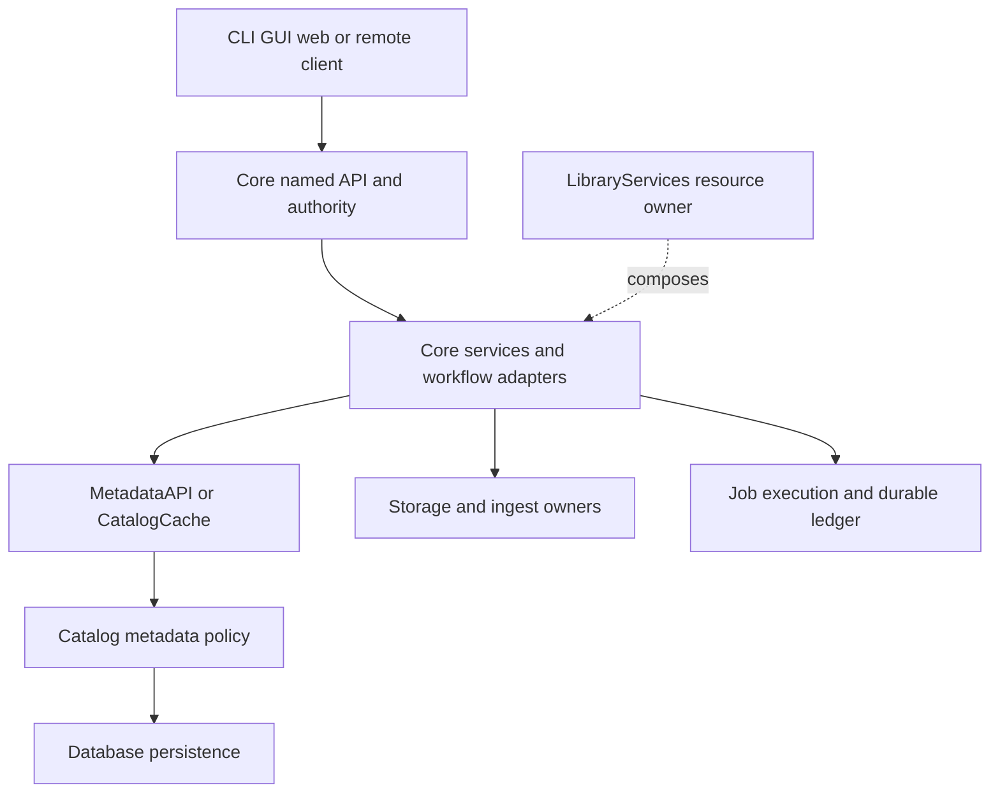

# Core review and completion plan

Reviewed **2026-11-23** against `04d6fd7d` on `core-review`, including the
metadata/lifecycle repairs in `eb096f3c` and the subsequent registration caller
migration. This covers the complete Core package: composition, dispatch, public
operations, transport, jobs, events, configuration and operational readiness.
The earlier [integration review](integration-review-2026-11-23.md) remains the
detailed evidence for metadata routing and lifecycle repairs.

**Assessment:** Core has a sound application boundary and substantial working
functionality. Keep its architecture and complete it incrementally. I would sign
off the tested native search/edit workflow and the repaired lifecycle boundary;
I would not yet sign off the whole module as a complete, recoverable application
service. Its principal weaknesses are uneven public contracts, incomplete native
metadata exposure, mixed job durability and insufficient bounds on synchronous
work. A fast cache does not remove those application-level limitations.

“Full functionality” here means a LiuXin-first service through which maintained
local and remote clients can perform the supported catalogue, metadata, storage,
ingest, conversion, backup and maintenance workflows without accessing internal
services. Every supported operation needs explicit inputs, authority, effects,
results, failure/recovery behavior and availability. Optional tools and backend
limitations must be represented honestly; declaring an unfinished operation
unavailable is an interim correction, not implementation of that operation.
Multi-tenant identity, arbitrary plugin sandboxing and multi-library hosting are
additional product designs, not prerequisites silently added to this scope.

## Architecture and current contents

The package contains **71 Python files and 32,611 physical lines**, including
comments and docstrings. A standard runtime installs **97 command routes and
111 query routes**. These counts describe surface area, not functional completeness.

| Layer and owners | Responsibility | Assessment |
| --- | --- | --- |
| `settings`, `factory`, `library_services` | Select a deployment, compose one library graph, own startup and shutdown | Correct home for composition; rollback and borrowed ownership now have strong coverage |
| `services` | Bind Catalog, metadata/cache, selected readers/writers, preferences, storage and maintenance | Good separation from dispatch; lazy lifetime and binding invariants were repaired |
| `runtime`, `description`, `authorization`, `wire` | Register named operations, serialize shared database access, enforce declared remote authority and encode results | Useful common boundary; registration, validation and recovery contracts need further consistency |
| `program_endpoints`, `program_services`, application/browse/schema/storage API modules | Adapt application requests to domain operations | Broad functionality, but several generations of API shape coexist |
| `api`, `readonly`, `proxies`, `transport.http` | Direct/RPC clients, restricted reads, HTTP envelopes and events | Shared named protocol works; local object access remains privileged and HTTP needs operational limits |
| `durable_jobs`, audit/maintenance handlers, `workflow_jobs` | Submit work and reopen independent library graphs | Durable audit and maintenance exist; other workflows still use utility execution |
| `store_registration` | Four synchronous registration helpers for existing catalogue paths | Correctly moved above handle-based ingest/storage; standalone CLI belongs to surfaces |

The normal dependency direction is:



The generic cache must stay generic; Catalog owns metadata invariants, while
CatalogCache coordinates metadata operations and derived state. Core should
adapt and orchestrate those owners, not become another metadata authority.

## Strengths worth preserving

1. **Resource ownership is explicit.** LibraryServices owns what it constructs,
   borrows injected resources and unwinds partial startup. The recent fixes also
   preserve displaced cache bindings and attempt independent closers after a
   failure. The four remaining registration path helpers now live in Core;
   ingest/storage no longer depend upward on Core for those operations.
2. **Native metadata editing is a real end-to-end workflow.** Search, ordered
   hydration, editable revisions, stale-save rejection and committed-write
   reconciliation receipts work through the same local/RPC boundary. The tested
   matrix covers SQLite/APSW, uncached use and all three cache backends.
3. **Domain authority largely stays below Core.** Catalog performs metadata
   validation and persistence. Storage managers enforce destructive-operation
   invariants. Core's receipt adapters preserve those distinctions instead of
   claiming that every successful command is one atomic transaction.
4. **Remote authority is explicit and fails closed.** Unannotated registrations
   are not exposed. Read, write, admin, execution and generic-invocation grants
   are separate. Writable deployments require credentials; host/origin/media
   checks and redirect refusal are covered by tests. A query name alone never
   grants read authority. These are deployment roles, not individual user accounts.
5. **Direct and remote stable results share an encoder.** It rejects unsupported
   process-owned results, nonfinite floats and ordinary mapping-key collisions.
   Native conflict and reconciliation errors retain structured details.
6. **Concurrency improvements respect the database.** Ordinary dispatch stays
   serialized around the shared connection; independent job waits/results can
   run concurrently. Durable workers open their own graphs. Removing the lock
   wholesale would lose this protection.
7. **The verification foundation is substantial.** There are tests for lifecycle
   failures, permissions before effects, wire contracts, queued shutdown, job
   recovery, profile propagation and metadata editing. The full quality gate
   enforces architectural direction and a growing typed scope. It is a useful
   foundation for expansion, although it is not proof that all endpoints are complete.

## Functional coverage

| Area | Working today | Remaining completion work |
| --- | --- | --- |
| Lifecycle and composition | Owned/borrowed graphs, partial-startup rollback, local factory, one-shot registration | Finish connection/settings propagation and retire remaining opt-ins only after migrating consumers |
| Native metadata | Search, `read_many`, `read_for_edit`, `update` | Expose coherent create/delete, shared records, suggestions, vocabulary trees, relationships and bounded batch operations |
| Existing catalogue API | Entity CRUD, WEMI construction, fields, agents, identifiers, links and repair routes | Consolidate contracts and route appropriate operations through the native metadata owner; preserve explicit legacy projections |
| Browse and acquisition | Category/work/item projections, format/cover/content delivery | Bound scans and content transfers, specify snapshot/completeness behavior and measure whole-Core latency |
| Storage | Stores/assets/replicas, policy, verification, audit, repair and evacuation adapters | Complete explicitly deferred repair actions where supported; move reusable placement/execution policy to storage with current-state checks |
| Ingest, conversion and backup | Named submissions and domain workflows, including persisted backup declarations | Durable application run identity, restart/retry/cancellation guarantees and reproducible worker settings across these families |
| Maintenance | Durable outbox delivery/drains/polling and audit/history paths | Built-in selective cleanup remains unimplemented; reconcile remaining thread/utility paths without losing domain obligations |
| Discovery and transport | Endpoint descriptions, static family manifest, role enforcement, HTTP request-length checks | Accurate availability, complete inventory, stricter schemas, bounded resources and recoverable command outcomes |
| Events | Local subscribers and a recent HTTP event buffer; separate durable job events | Explicit history gaps, restart-aware cursors, resynchronization and visible subscriber failures |

Older Catalog routes already provide much of the underlying metadata behavior.
The native API gap is a coherent application contract over the new metadata
service, not an absence of every operation listed above.

## Findings and weaknesses

Priority **P1** means address before claiming complete supported workflows;
**P2** means complete before broad operational sign-off. Observed behavior is
separated from proposed changes below.

### F1 Capability discovery overstates completeness

**P1.** [`program_services/discovery.py`](../../src/LiuXin_alpha/core/program_services/discovery.py)
compares registrations with a hand-maintained subset. A fresh runtime reports
`complete_program_boundary=True` while **59 registered operation names are absent
from that manifest**, including all four native metadata routes and native custom
field operations. `maintenance.clean` is advertised as `availability="available"`,
but the default implementation returns `capability_unavailable` without cleaning.
The existing maintenance regression verifies that refusal and preservation of rows.

Build discovery from the actual registration inventory, with explicit family,
implementation status, backend/tool prerequisites and unavailable reasons. Keep
passive capability inspection separate from optional expensive readiness probes.
Report permissions separately from implementation/readiness. Implement selective
cleanup through its domain owner; correcting the label alone does not finish it.

### F2 Native metadata exposure stops before a complete editing application

**P1.** [`native_metadata.py`](../../src/LiuXin_alpha/core/program_services/native_metadata.py)
registers search/read-many/read-for-edit/update only. The
[metadata interface](../../src/LiuXin_alpha/catalog/api/metadata_access.py),
[shared records](../../src/LiuXin_alpha/catalog/api/metadata_shared.py) and
[vocabulary trees](../../src/LiuXin_alpha/catalog/api/metadata_trees.py) support
much more: creation/deletion, shared-record edits, suggestions, WEMI construction,
relationships, batch work and tree editing. Clients currently need older named
routes or privileged Python objects for these workflows.

Add named, typed adapters over the existing metadata service, including its
revisions, receipts and transaction semantics. A remote batch must execute as
one bounded request with a defined transaction policy, not expose an ambient
transaction across HTTP calls. Keep Item/Calibre projection and file-metadata
conversion explicit; they are different contracts from native WEMI editing.

### F3 Command failure does not always describe whether effects occurred

**P1.** [`runtime.execute_command`](../../src/LiuXin_alpha/core/runtime.py)
performs result encoding after the handler. A probe handler that records an effect
and returns an unsupported object produces `handler_error` with only
`exception_type=CoreWireError`. That response cannot establish whether an ordinary
caller should retry. Native metadata reconciliation already preserves a stronger
receipt, but that protection is not universal.

Reusing the same `CoreCommand.command_id` also executes the handler twice;
identifiers currently correlate requests rather than deduplicate effects.
The remote client correctly avoids automatic command retries, which limits the
problem but leaves recovery to clients. This is distinct from the durable job
submission identity that already exists.

Specify effect states such as rejected, committed, partially completed and unknown,
with operation-specific receipts. Add durable request identity and receipt lookup
for replayable writes, atomically with authoritative mutation where possible.
External effects need domain recovery identities and checkpoints; do not promise
universal exactly-once execution across database and filesystem/network effects.

### F4 Legacy payload coercion can select a different entity

**P1.** In [`program_services/payloads.py`](../../src/LiuXin_alpha/core/program_services/payloads.py),
`_required_int({"id": 1.9}, "id")` returns `1`; `_required_text` turns explicit
`None` into `"None"`. Several switches use truth conversion, so a string such as
`"false"` is true. Endpoint field descriptions are documentation rather than
executable schemas. The newer native metadata ID validator is already stricter.

Use strict wire models for identifiers, booleans, finite bounds, enums and nested
structures before effects occur. If a CLI accepts convenient strings, convert
them at the CLI boundary. Domain validation stays in Catalog/storage. Keep one
error shape for invalid payloads across direct and RPC calls.

### F5 Diagnostic redaction leaves some credential forms visible

**P1.** [`settings.redacted_manifest`](../../src/LiuXin_alpha/core/settings.py)
masks selected keys and URL authority passwords. Synthetic probes retain
`?password=synthetic-query` inside a database URL and passwords under arbitrary
nested mappings. The configuration CLI uses this helper when printing manifests.
This concerns diagnostic output; it is not evidence of an authorization bypass.

Define an allowlisted diagnostic projection or recursively redact supported
secret fields and credential-bearing URL components. Test mappings, arrays,
malformed URLs and connection metadata. Do not silently mutate connection values
used to open the library, and avoid putting real credentials in test fixtures.

### F6 Paging and request-length checks do not bound total work

**P1.** [`search_global`](../../src/LiuXin_alpha/core/program_services/catalog.py)
scans and flattens the selected populations before paging. Some asset lists also
materialize their entire source before slicing.
[`storage_file_read`](../../src/LiuXin_alpha/core/application_api.py) reads a whole
file without an adapter content cap. Such handlers occupy shared dispatch while
running. A query returning ten rows can therefore still scan a large catalogue or
block unrelated work.

[`CoreHttpDaemon`](../../src/LiuXin_alpha/core/transport/http.py) defaults to a
**1 GiB** declared-body limit and uses a threaded HTTP server. The implementation
has no application-level aggregate request/memory budget or body-read deadline;
JSON output is built in memory. The wire encoder has no explicit depth/cycle
budget. These are missing limits, not measured evidence of a particular latency
or exploitable deployment.

Bound scan scope, hydration batches, response bytes, nesting and admitted work.
Use storage streaming/range delivery for large content and jobs for long
operations. Introduce concurrency only for work with independent resources or a
safe captured snapshot. Measure end-to-end p50/p95 latency and peak memory under
mixed reads, writes and jobs; cache-only measurements do not establish them.

### F7 Durable work covers only selected families

**P1.** [`DurableJobService`](../../src/LiuXin_alpha/core/durable_jobs.py)
registers storage-audit and maintenance handlers. `RoutedJobManager.submit`
still forwards ordinary submissions to the utility manager, including ingestion,
conversion and backup adapters. A durable backup definition or a domain checkpoint
does not itself make its Core submission/reply durable. Some worker adapters also
create their own unset cancellation event rather than receiving run cancellation.

Extend the existing [claim](../jobs/durable-claims.md) and
[submission identity](../jobs/submission-identity.md) contracts, one workflow family
at a time. Preserve ingest/backup recovery journals where they track domain
progress. Give each application run one authoritative state, explicit possible-
effect retry rules, cancellation checkpoints and receipt publication. The factory's
durable worker closure already preserves connection metadata/preferences;
older path/type-only worker adapters need equivalent connection-selection tests.

### F8 Command replacement changes an in-flight result contract

**P2.** Queries capture handler, authority, scheduling and result policy together.
Commands capture their handler and authority but reread result metadata after
execution. A deterministic probe replaces a command from a `command.started`
subscriber: the old handler returns an opaque object, while the replacement's
`transport_stable=False` causes that object to escape local wire validation.

Capture an immutable command registration as already done for queries. Apply
replacement only to future requests. Add a regression covering replacement both
while queued and inside execution. The reproduced defect concerns result-policy
consistency; it does not demonstrate execution of an unauthorized replacement
handler.

### F9 General events cannot support reliable client resynchronization

**P2.** The HTTP daemon keeps the latest 1,000 events. After publishing 1,005,
a cursor at zero receives sequence 6 with no explicit gap field. A new daemon
instance begins a new sequence, while remote subscriptions track an integer
cursor and retry HTTP failures. There is no general restart/gap handshake.
Local subscribers run synchronously, receive shared payload objects and have
ordinary exceptions swallowed. Slow callbacks can delay the emitting request.

Specify an instance-aware cursor, oldest/newest retained sequence and a
resynchronization response. Clients should refresh authoritative state after a
gap, not infer that a missing event means no change. Bound subscriber queues and
surface dropped delivery/errors. General UI events need not all become durable;
job recovery continues to use the existing durable job event log.

### F10 Configuration and code ownership still have unfinished edges

**P2.** Fresh import of
[`utils.ptempfiles`](../../src/LiuXin_alpha/utils/ptempfiles.py) installs a
`PyQt4Ban` import hook and adds `builtins.lopen` through the startup package.
That reproduces the open CORE-04/A12 concern. Configuration paths and submitting
worker profiles already have good isolation tests; this finding does not negate
those guarantees. Process-default/component singletons still need an explicit
capture/reload policy when switching profiles.

Core also retains substantive storage placement/evacuation policy and several
large API owners: `application_api.py` is 3,457 physical lines and `runtime.py`
2,675, including documentation. Modern service/provider modules are a useful
pattern, but typing/lint scope is selective and many public payloads remain `Any`.
Size alone is not a defect. Extract coherent operations only when their receiving
owner, caller migration and behavioral tests are clear. Reusable storage policy
belongs in storage; Core retains authority, orchestration and wire adaptation.

## Ordered implementation plan

These are new completion slices mapped to the existing Core tasks. They preserve
the already completed integration and caller-migration commits. Each slice should
be independently reviewable; split a large family migration into multiple commits
without weakening its completion checks.

| Order | Work and owner | Dependencies | Completion evidence |
| --- | --- | --- | --- |
| 1 | **Contract corrections:** capture command registrations; strict primitive validators; complete discovery inventory and truthful unavailable states; safe configuration diagnostics | Existing dispatch, endpoint descriptions and configuration owners | Reproduce F1/F4/F5/F8, then tests prove strict refusal before effects, stable in-flight policy and accurate discovery across local/RPC roles |
| 2 | **Configuration closure:** passive scratch-path owner, explicit component lifetime, complete resolved connection/settings propagation | CORE-04/A12; existing `ConfigurationPaths` and preference context | Fresh imports add no hooks/directories; two profiles and spawned workers retain independent settings; SQLite/APSW and PostgreSQL selector/metadata forms reopen correctly |
| 3 | **Native metadata completion:** named create/delete, shared records/suggestions, tree operations, relationships, WEMI construction, bounded batch editing and search-schema discovery | Slice 1; existing MetadataAPI/CatalogCache interfaces | Full create/search/select/edit/link/move/delete/readback scenarios locally and remotely, with revisions, no-op behavior, detach rules and publication-failure receipts across cache modes |
| 4 | **Recoverable commands:** effect classification, operation receipts, durable idempotency where supported and receipt lookup after connection loss | Slice 1; coordinate with Catalog transactions and existing job submission identity | Drop reply after commit, resend same identity, restart service, inject serialization/publication failure; no duplicate canonical effect and explicit unknown/partial results where atomicity is unavailable |
| 5 | **Durable long workflows:** ingest/sync, conversion, backup/publication/restoration and remaining maintenance operations | Slice 2 and existing durable jobs; reuse slice 4's receipt vocabulary | Crash/reopen at pre-effect, mid-effect and post-effect boundaries; cancel at checkpoints; recover stale leases; preserve domain journals; verify independent graph cleanup and retry ancestry |
| 6 | **Bounded application execution:** scan/hydration limits, streaming/range content, output/body/depth budgets, admission control and long-operation migration | Slices 3/5 for native reads and background execution | Mixed-load measurements with explicit latency/memory budgets, oversized/slow-client refusal, responsive health/cancel, stable snapshots and unchanged database transaction isolation |
| 7 | **Event recovery and observability:** instance-aware cursors, gaps/resync, bounded delivery, structured effect/job telemetry and readiness | Slices 4/5; existing general and durable job events | Overflow/reconnect/restart/slow-subscriber cases; state converges after a gap; diagnostics omit secrets; readiness distinguishes starting, degraded, ready and closing |
| 8 | **Domain and API consolidation:** implement selective cleanup, finish supported deferred repair actions, extract storage policy, retire superseded adapters after caller migration | Slices 1/3/5; coordinated Catalog/storage work | Every required operation implemented on supported backends; domain invariants identical through all entry points; no new upward dependencies or compatibility facades; API inventory and strict typing coverage expand |
| 9 | **Acceptance and release:** publish supported capability/backend matrix and operational runbooks | All preceding slices | The sign-off scenarios below pass; current evidence is attached to the reviewed revision; remaining optional limitations are explicit rather than hidden behind a completeness flag |

Start with slice 1. It is bounded and corrects misleading or unsafe contracts
before expanding them. Configuration remains the next architectural migration,
followed by native metadata completeness. Avoid a wholesale runtime rewrite or
another top-level service package.

## Full functionality sign-off criteria

- **Application workflows:** one maintained client can create a native WEMI graph,
  manage shared metadata and trees, search/edit with revisions, attach/acquire
  content, convert, back up, restore/recover, maintain and delete under policy
  using named Core operations. Each required declared operation has an actual
  implementation; optional prerequisite failures have specific unavailable reasons.
- **Backend and cache matrix:** SQLite and APSW, uncached and all supported cache
  modes, local and HTTP, plus an explicitly provisioned PostgreSQL run covering
  supported operations, schema upgrades and worker reopening. Backend-specific
  exclusions must follow real capability differences, not skipped tests alone.
- **Failure and recovery:** stale edits, partial startup, failing closers,
  post-commit response loss, duplicate delivery, interrupted external effects,
  job restart, cancellation, event gaps and service restart preserve authoritative
  state and give clients sufficient receipts to continue safely.
- **Authority and resources:** each endpoint declares its required authority and
  strict payload/result contract. Refused requests have no effects. Runtime/job
  ownership remains explicit. Supported deployment limits bound memory, body
  reads, scan work, content transfer, queued requests and background execution.
- **Operational evidence:** representative and gated long-running tests record
  workload size, backend, concurrency, latency, memory, cleanup and recovery.
  Profile selection and diagnostics are safe to use in support/runbooks. Quality
  gates cover changed owners and no regression is hidden in a loosened baseline.

A multi-user service would additionally need user identity/authorization design,
credential lifecycle and its deployment threat model. A non-loopback deployment
needs encrypted transport, normally supplied by its deployment boundary. Neither
should be confused with today's tested bearer-token deployment roles.

## Verification and practical limits

The existing integration run passed **405 tests with one live PostgreSQL skip**;
the separate caller migration passed **229 tests**, including documentation and
boundary checks. Their logs and source scope were inspected again for this review.
The latest complete quality run passed formatting/lint/architecture checks,
31 cold-import budgets, basedpyright, mypy over 573 files and 127/123 negative
contract examples. These are separate selections with overlapping coverage,
not a combined unique-test count.

The additional whole-Core selection below passed **107 tests with one live
PostgreSQL skip in 135.43 seconds**, including local/RPC authority, job waiting,
durable audit/maintenance, wire/request limits and configuration propagation.
All **22 documentation/navigation/boundary checks** also passed.
Disposable probes on the reviewed revision reproduced F1, F3,
F4, F5, F8 and F9 using a fake library and synthetic values, with no application
library or external service involved. A fresh subprocess reproduced F10's import
side effects. These are characterization evidence, not passing acceptance tests
for the proposed fixes.

The review examines every Core responsibility and its major entry-point owners;
it is not a line-by-line certification of every plugin/backend or a production
load test. No live PostgreSQL server, external crawler, tape device or optional
conversion tool was exercised by the probes. The plan includes the missing
workflow and operational evidence needed for whole-module sign-off.

Useful regression selection:

```bash
PYTHONPATH=src .venv/bin/python -m pytest -q \
  tests/core/test_transport_authorization.py \
  tests/core/test_job_wait_dispatch.py \
  tests/core/test_durable_storage_audit.py \
  tests/core/test_durable_maintenance.py \
  tests/core/test_core_wire.py \
  tests/core/test_core_http_request_limit.py \
  tests/preferences/test_configuration_ownership.py
```

Loopback listener access is required. Run quality tools separately from pytest
because the repository artifact guard observes newly created root caches.

Return to [Core](README.md), [next tasks](next_tasks.md), or the
[metadata and lifecycle review](integration-review-2026-11-23.md).
