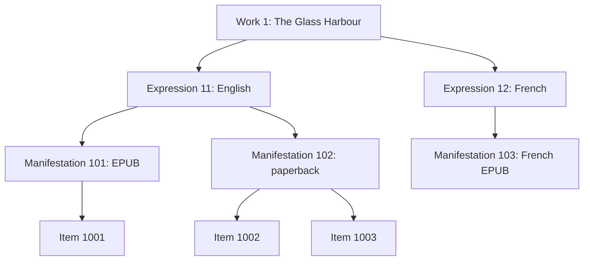
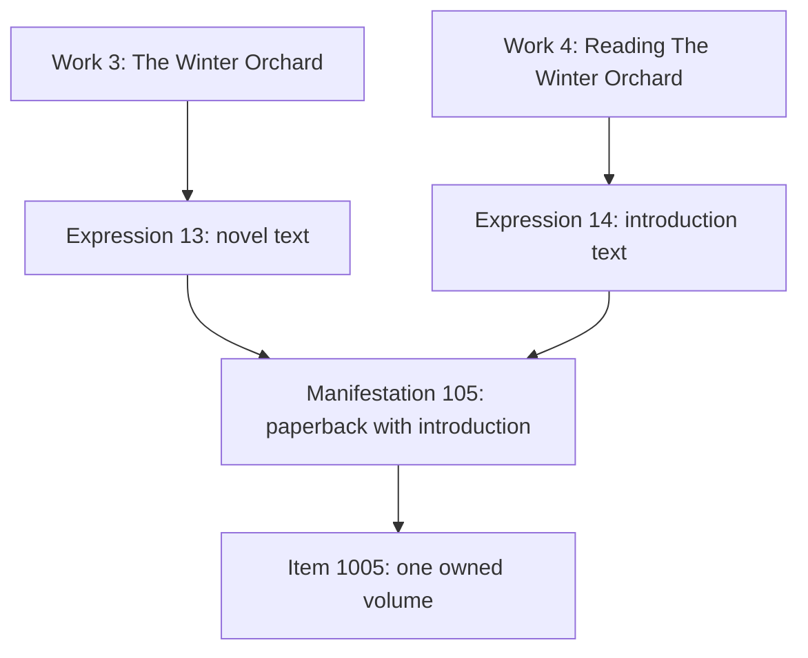

# Worked examples: WEMI and other links

Reviewed **2026-10-20**. A07 aligns Catalog bundles with the existing SQL complete-ray
ranking; the [selection contract](../catalog/catalog-wemi-selection.md) states
partial-path and metadata-hydration distinctions. The graph and selected outputs
below are exercised by [real SQLite/APSW regressions](../../tests/catalog/retrieval/test_wemi_selection.py).

Checked: **2026-10-19**, against the current FRBR SQLite schema and view definitions.

These examples start with a fictional novel, *The Glass Harbour*, then add volumes
containing several Works. Each example extends the preceding one unless stated
otherwise. IDs are illustrative integers, not identifiers to reuse in an existing
library. The tables show selected stored columns; the SQL queries inspect those
rows. Application writes use the [Catalog API](../catalog/catalog-api-usage.md).

Read alongside the [schema overview](<../03 - Database Schema.md>). A link row is
an assertion about two existing records. It can carry ordering, role or provenance
without copying either endpoint's data.

## 1. One novel, two languages, three editions and three owned copies

Create these bibliographic records:

| Table | ID | Meaning |
| --- | --- | --- |
| `works` | 1 | *The Glass Harbour*, the novel. |
| `expressions` | 11 | English text. |
| `expressions` | 12 | French translation. |
| `manifestations` | 101 | English EPUB edition. |
| `manifestations` | 102 | English paperback edition. |
| `manifestations` | 103 | French EPUB edition. |

The English EPUB and paperback embody the same Expression because this example
assumes the same text. The translation has its own Expression. A substantive text
revision would require a separate cataloguing decision rather than being inferred
from its filename or format.

### Work–Expression links

The two rows in `expression_work_links` are:

| work_id | expression_id | priority | primary | origin |
| --- | --- | --- | --- | --- |
| 1 | 11 | 0 | 1 | `curation` |
| 1 | 12 | 10 | 0 | `curation` |

Headers omit the shared `expression_work_link_` prefix: `work_id`, for example,
means `expression_work_link_work_id`. The link row also has its own generated ID.

The first row means “Expression 11 realizes Work 1”; the second says the same
about Expression 12. The Work's title is stored once. The link's `primary` value
is separate from any `expression_is_preferred` field on the Expression itself.

### Expression–Manifestation links

In `expression_manifestation_links`, with `expression_manifestation_link_`
omitted from these headers:

| expression_id | manifestation_id | priority | primary | origin |
| --- | --- | --- | --- | --- |
| 11 | 101 | 0 | 1 | `curation` |
| 11 | 102 | 10 | 0 | `curation` |
| 12 | 103 | 0 | 1 | `curation` |

Expression 11 has two embodiments. There is no direct Work–Manifestation link:
the Work is reached through the Expression.

### Manifestation–Item ownership

Suppose the library owns one English EPUB copy and two paperback copies:

| item_id | item_manifestation_id | item_type | item_inventory_code |
| --- | --- | --- | --- |
| 1001 | 101 | `digital` | `EBOOK-001` |
| 1002 | 102 | `physical` | `SHELF-A-001` |
| 1003 | 102 | `physical` | `SHELF-A-002` |

These are actual `items` columns. There is no extra Manifestation–Item link row:
the Item's foreign key records the relationship. The French edition exists in the
catalogue even though the library has not recorded an Item for it.



A *ray* is one Work–Expression–Manifestation path, without an Item:

```sql
SELECT ray_id, work_id, expression_id, manifestation_id
FROM wemi_rays_v
WHERE work_id = 1
ORDER BY expression_id, manifestation_id;
```

| ray_id | work_id | expression_id | manifestation_id |
| --- | --- | --- | --- |
| `1:11:101` | 1 | 11 | 101 |
| `1:11:102` | 1 | 11 | 102 |
| `1:12:103` | 1 | 12 | 103 |

`wemi_ray_items_v` expands the paperback ray to two rows, one for each owned
copy. It retains the French ray with `item_id = NULL`. These are three rays and
three Items, but the expanded view has four rows. Row counts and copy counts
answer different questions.

## 2. A bilingual edition shares two Expressions

Add Manifestation **104**, a bilingual paperback containing the English and French
texts already represented by Expressions 11 and 12. Add these rows to
`expression_manifestation_links`:

| expression_id | manifestation_id | priority | primary | origin |
| --- | --- | --- | --- | --- |
| 11 | 104 | 20 | 0 | `curation` |
| 12 | 104 | 10 | 0 | `curation` |

Add Item **1004**, with `item_manifestation_id = 104` and inventory code
`BILINGUAL-001`. This records one owned bilingual copy.

```sql
SELECT ray_id, item_id
FROM wemi_ray_items_v
WHERE manifestation_id = 104
ORDER BY ray_id, item_id;
```

| ray_id | item_id |
| --- | --- |
| `1:11:104` | 1004 |
| `1:12:104` | 1004 |

The Item appears on two paths because its Manifestation embodies two Expressions.
There is still only one Item row. For a physical-copy count, count Item identities
within the intended scope rather than counting joined paths.

This is why `items.item_manifestation_id` is singular while the links above it
are many-to-many. One Item can have several paths back to a Work without needing
several Manifestation foreign keys.

## 3. Sharing an Expression between Works shares its paths too

For a volume containing distinct Works, such as a novel and its introduction,
see [example 6](#6-a-novel-and-its-introduction-share-one-manifestation).
The example here explores a different assertion: two Works sharing one Expression.

Suppose a cataloguing decision also associates the existing English Expression
with Work **2**, *The Harbour Collection*. Add one `expression_work_links` row:

| work_id | expression_id | priority | primary | origin |
| --- | --- | --- | --- | --- |
| 2 | 11 | 0 | 1 | `collection-cataloguing` |

No Expression, Manifestation or Item is copied. Query the paths through Expression 11:

```sql
SELECT ray_id
FROM wemi_rays_v
WHERE expression_id = 11
ORDER BY work_id, manifestation_id;
```

| Work 1 paths | Work 2 paths |
| --- | --- |
| `1:11:101` | `2:11:101` |
| `1:11:102` | `2:11:102` |
| `1:11:104` | `2:11:104` |

The query returns six rows; the table groups them by Work for comparison.
All three Manifestations of Expression 11 are reachable from both Works.
The bilingual Item 1004 now appears on three rays in total: two through Work 1,
and one through Work 2.

That is a consequence of sharing the Expression, not a rule that every collection
should be catalogued this way. The two binary link tables cannot say “Expression
11 belongs to Work 2 only when reached through Manifestation 104”. If that is the
intended assertion, this shared-Expression model is too broad. Decide the
bibliographic model through Catalog's identity/workflow policy before adding links.

Neither `primary` nor `origin` restricts reachability. They do not turn this into
a context-dependent three-way relationship or merge the two Work identities.

## 4. Primary selection changes a default view, not membership

For the rows above, this query selects the English EPUB path for each Work:

```sql
SELECT work_id, ray_id
FROM wemi_primary_rays_v
ORDER BY work_id;
```

| work_id | ray_id |
| --- | --- |
| 1 | `1:11:101` |
| 2 | `2:11:101` |

The SQLite view and Catalog bundles rank each Work's complete rays by:

1. Work–Expression `primary`, descending, then its `priority`, ascending.
2. Expression–Manifestation `primary`, descending, then its `priority`, ascending.
3. Expression ID, then Manifestation ID, ascending, to break remaining ties.

For this ranking, `NULL` primary/priority values become zero. A smaller priority
therefore wins within an otherwise equal group in **this preferred-path policy**. Use explicit
priorities when creating multiple ordered links; current WEMI constraints require
non-null priorities to be unique per Work or Expression at the corresponding
parent boundary.

To make the French Expression primary for Work 1 through the public API, assuming
`catalog` contains these example records:

```python
catalog.mutations.writer.link_wemi(
    parent_level="work",
    parent_id=1,
    child_level="expression",
    child_id=12,
    primary=True,
    priority=10,
    origin="curation",
)
```

Catalog sets that link's primary flag and demotes the previous primary sibling
for Work 1. The default view then returns `1:12:103` for Work 1; Work 2 still
selects `2:11:101`. All eight complete rays remain in `wemi_rays_v`.

The schema's primary column alone does not enforce one primary child. The
coordinated Catalog operation establishes that invariant; the SQL view can still
choose one result if it encounters several marked rows. A path also needs both
W–E and E–M links to appear in the ray view, regardless of its primary flags.

### Default SQL view versus Catalog bundles

Both now use the ranking above for complete rays. For the graph through example 4:

| Stage | SQL primary ray for Work 1 | Catalog `for_work(1)` IDs: W/E/M/I |
| --- | --- | --- |
| Before changing the primary link | `1:11:101` | `1 / 11 / 101 / 1001` |
| After making French primary | `1:12:103` | `1 / 12 / 103 / None` |

The French edition has no owned Item in this example. That does not make Catalog
choose the bilingual paperback instead. Work 2 still selects `2:11:101`.
Repository **lists** retain descending-priority order and all relationships;
their first row is not the preferred-path API.

If a preferred Expression has no Manifestation but another complete ray exists,
both selectors choose a complete ray. If none exists, the SQL view has no row;
Catalog retains the fullest available partial path, such as
`Work 1 / Expression 12 / None / None`. These are intentional absence contracts.

A bundle for Item 1004 selects one ranked ancestor path; it does not
prove that the Item has only one Expression or Work ancestor. Use hierarchy or
bounded graph retrieval when the operation needs the other relationships. See the
[Catalog retrieval guide](../catalog/catalog-api-usage.md#bundles-and-projections).
Metadata containers' primary-relation accessors select within one relation bucket,
not across complete rays; their separate ordering and source-hint semantics are
described in the [selection contract](../catalog/catalog-wemi-selection.md).

## 5. Roles on links: author, translator and payload

Structural WEMI links connect adjacent bibliographic levels. Credits and asset
attachments describe different kinds of relationships.

Suppose Agents **501** and **502** are the author and translator. Selected link
columns, again shown without each table's shared prefix, are:

| Table | Endpoints | type | priority | Meaning |
| --- | --- | --- | --- | --- |
| `agent_work_links` | agent 501 → work 1 | `aut` | 0 | Authorship of the novel. |
| `agent_expression_links` | agent 502 → expression 12 | `trl` | 0 | Translation credit for the French realization. |

`aut` and `trl` are role codes; `origin` or `source` can record where an assertion
came from, where those columns exist. Neither field should be used to store the
credit role. Different people can contribute at different WEMI levels without
copying their Agent record into a new author or publisher table.

For the digital Item 1001, add atomic asset **401**, the acquired English EPUB
payload, and this `digital_asset_item_links` row:

| digital_asset_id | item_id | type | priority | primary |
| --- | --- | --- | --- | --- |
| 401 | 1001 | `primary_payload` | 0 | 1 |

Now store two replicas of asset 401:

| asset_replica_id | digital_asset_id | store_id | storage_key | mode |
| --- | --- | --- | --- | --- |
| 601 | 401 | 701 | `novels/glass-harbour.epub` | `active` |
| 602 | 401 | 702 | `archive/glass-harbour.epub` | `backup` |

Replica headers other than the primary key omit `asset_replica_`. Store 701 must
support active replicas and store 702 backup replicas. There is one bibliographic
Item, one atomic asset and two physical copies. Adding the backup does not create
another Item or WEMI ray. Moving a replica changes storage placement; assigning
a different Manifestation changes bibliographic ownership.

## 6. A novel and its introduction share one Manifestation

Consider another novel, *The Winter Orchard*, published with a separately authored
introduction, *Reading The Winter Orchard*. We choose to catalogue the introduction
as a Work in its own right so that it can have its own title, authorship and later
embodiments. That is a cataloguing choice, not a requirement for every preface.

Add these records to the catalogue:

| Table | ID | Meaning |
| --- | --- | --- |
| `works` | 3 | *The Winter Orchard*, the novel. |
| `works` | 4 | *Reading The Winter Orchard*, the introduction. |
| `expressions` | 13 | English text of the novel. |
| `expressions` | 14 | English text of the introduction. |
| `manifestations` | 105 | Paperback edition containing the introduction and novel. |
| `items` | 1005 | One owned paperback, with `item_manifestation_id = 105`, `item_type = physical` and inventory code `ORCHARD-001`. |

The `expression_work_links` rows keep the two intellectual creations separate:

| work_id | expression_id | priority | primary | origin |
| --- | --- | --- | --- | --- |
| 3 | 13 | 0 | 1 | `curation` |
| 4 | 14 | 0 | 1 | `curation` |

The `expression_manifestation_links` rows bring their texts into one edition:

| expression_id | manifestation_id | priority | primary | origin |
| --- | --- | --- | --- | --- |
| 13 | 105 | 0 | 1 | `curation` |
| 14 | 105 | 0 | 1 | `curation` |

Each Expression has its own primary Manifestation link. These flags do not say
which text is the main content of the volume, and these priorities do not encode
the introduction's page order: they order Manifestations for each Expression.

All link ranks tie here, so `catalog.retrieval.bundles.for_item(1005)` chooses
`3 / 13 / 105 / 1005` by Expression ID. `for_work(4)` still returns
`4 / 14 / 105 / 1005`. Choosing the novel as a default does not remove the
introduction, and it is not a claim about its relative importance.



“The Manifestation embodies multiple Works” is shorthand here: it embodies their
Expressions, and the Works are reached through those separate paths. There is no
direct Work–Manifestation link and no need to share an Expression between the
novel and the introduction.

```sql
SELECT ray_id, work_id, expression_id, manifestation_id, item_id
FROM wemi_ray_items_v
WHERE manifestation_id = 105
ORDER BY work_id, expression_id, item_id;
```

| ray_id | work_id | expression_id | manifestation_id | item_id |
| --- | --- | --- | --- | --- |
| `3:13:105` | 3 | 13 | 105 | 1005 |
| `4:14:105` | 4 | 14 | 105 | 1005 |

These are two Works, two Expressions, one Manifestation and one Item. Searching
either Work can reach the same owned volume. Counting these joined rows as copies
would count that volume twice.

For separate authors, add Agents **503** (the novelist) and **504** (the introduction
writer), then these `agent_work_links` rows:

| agent_id | work_id | type | priority |
| --- | --- | --- | --- |
| 503 | 3 | `aut` | 0 |
| 504 | 4 | `aut` | 0 |

The introduction writer is the author of Work 4. Sharing a Manifestation does not
make that person a co-author of Work 3. Likewise, a translation of the introduction
would get another Expression under Work 4 without implying a translation of the
novel. Any edition containing that translation would need its own explicit links.

## 7. An omnibus contains two novels, without the introduction

Now publish *The Winter Orchard* alongside a second novel, *The Summer Road*, in
one omnibus. Assume the first novel's text is unchanged, so reuse Expression 13.
Add Work **5**, *The Summer Road*, and Expression **15**, its English text, with this
`expression_work_links` row:

| work_id | expression_id | priority | primary | origin |
| --- | --- | --- | --- | --- |
| 5 | 15 | 0 | 1 | `curation` |

Add Manifestation **106**, the omnibus edition, and these
`expression_manifestation_links` rows:

| expression_id | manifestation_id | priority | primary | origin |
| --- | --- | --- | --- | --- |
| 13 | 106 | 10 | 0 | `curation` |
| 15 | 106 | 0 | 1 | `curation` |

Add Item **1006**, with `item_manifestation_id = 106`, `item_type = physical` and
inventory code `OMNIBUS-001`. Inspect both new volumes:

`for_item(1006)` selects `5 / 15 / 106 / 1006`: the omnibus is Expression 15's
primary edition, while Expression 13 prefers Manifestation 105. Both Works
remain reachable in the following complete-path query.

```sql
SELECT ray_id, item_id
FROM wemi_ray_items_v
WHERE manifestation_id IN (105, 106)
ORDER BY manifestation_id, work_id, expression_id, item_id;
```

| ray_id | item_id |
| --- | --- |
| `3:13:105` | 1005 |
| `4:14:105` | 1005 |
| `3:13:106` | 1006 |
| `5:15:106` | 1006 |

Across these two editions there are three Works, three Expressions, two
Manifestations and two owned Items. Work 3 reaches both volumes. The introduction
belongs only to Manifestation 105 because Expression 14 has no link to 106;
sharing a volume with the novel does not attach it to every edition of that novel.

If the omnibus also prints the unchanged introduction, add an Expression
14 → Manifestation 106 link with `priority = 10`, `primary = 0` and
`origin = curation`. That adds ray `4:14:106` for the existing Item 1006: three Works
in one volume, still one owned copy of that edition. This pattern also supports
an anthology whose stories are catalogued as separate Works. An additional Work
for the collection itself would be a further cataloguing decision; it is not
created automatically by sharing a Manifestation.

## Changing a link is distinct from deleting a record

The public operation for relating existing adjacent WEMI records is
`catalog.mutations.writer.link_wemi`; use `unlink_wemi` to remove the relationship.
Only Work–Expression, Expression–Manifestation and Manifestation–Item pairs are
accepted.

For example, unlinking Work 1 from Expression 11 removes that edge while retaining
the Expression, both Work records and the Manifestations. Work 2 still reaches
Expression 11. Unlinking does not automatically promote another primary sibling.
The next preferred-path read ranks the remaining candidates. For example,
unlinking the newly primary French Expression 12 from Work 1 restores the English
path `1:11:101` without changing its stored primary flag back to one.

Linking Item 1004 to Manifestation 101 instead would update its single foreign key
and replace its previous Manifestation 104 relationship. That operation accepts
no priority/origin metadata because no separate link row exists. It does not
create a second ownership edge or transfer file bytes.

For concrete call signatures, see [Catalog WEMI operations](../catalog/catalog-api-usage.md#wemi-levels).
For physical columns and capabilities, see [link capabilities](link-capabilities.md)
and the [schema overview](<../03 - Database Schema.md#how-to-read-a-relationship-table>).
