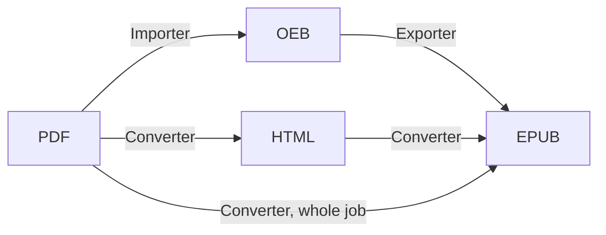

# Capability providers for file formats

Date: 2026-11-16

Status: **Proposal for review. Nothing here is implemented.**
Source checkpoint: `main` at `2d2a9cc3`.

This briefing records an architecture discussion with the maintainer on
2026-11-16. It proposes replacing the inherited one-plugin-per-format model in
`file_formats` with typed capability providers, conversions built from
composable steps, and recorded provenance. Decisions the maintainer has made
are marked **decided**; the rest are proposals to accept, change or reject.

Code and SQL in this guide are sketches that show shape. Names, signatures and
columns are open to change in review.

## The short version

- Every kind of operation gets **one base class**. A plugin subclasses the
  capabilities it provides, and the registry keeps a typed list per capability.
- **Several providers** can serve the same capability and format. Settings
  choose the default; a run can override it; a fallback chain is allowed.
- A **conversion is a route through providers**, not a fixed pair of plugins.
  A provider can import to an intermediate, export from one, or do a whole
  format-to-format job, and routes can chain.
- **OEB and HTML are both intermediates.** More can be added by name.
- **Routes have names**, such as `pdf.compress`. A route may start and end in
  the same format, so compression, OCR and repair pipelines fit.
- **Transforms** between import and export are their own capability and run in
  fixed, named stages.
- Each run records **which provider ran on which file**, and each metadata
  value records **which run claimed it**.

## Why change

The format plugins still follow calibre's model. Three properties of it limit
what the project can do without dropping formats.

1. **One implementation per format.** `plugin_for_input_format`
   (`file_formats/plugin_runtime.py:756`) returns the first plugin whose
   `file_types` contains the extension. Two readers for one format cannot
   coexist as choices.
2. **Conversion is one fixed box.** `Plumber.run`
   (`file_formats/conversion/plumber.py:1549`) takes one input plugin and one
   output plugin and always goes through OEB. A tool that performs a whole
   conversion, or a route through HTML, has no place in it.
3. **Nothing records what ran.** A converted file or an extracted author
   carries no record of the plugin, version or options that produced it.

A fourth, shared state on plugin instances (`site_customization` is assigned
per call), belongs to execution and lifetime, which this proposal leaves to
[PL-02](next_tasks.md).

## Decisions so far

| Topic | Position | Status |
| --- | --- | --- |
| One base class per capability; a class may inherit several | Typing and the registry both stay simple | **Decided** |
| Several providers per capability and format | Default in settings, per-run override, fallback chain | **Decided** |
| Results record the provider that ran | Part of every result | **Decided** |
| Input and output providers chosen independently | Each with its own default settings | **Decided** |
| Whole-conversion providers and chains | First-class, alongside import and export | **Decided** |
| Intermediates | OEB and HTML to start; not OEB alone | **Decided** |
| Named routes | Every route has a name; a format pair's default points at one | **Decided** |
| Same-format routes (loop-backs) | Supported in all three forms | **Decided** |
| Output of a same-format route | Another file for the same Manifestation, recorded as derived; the original stays | **Decided** |
| Provenance of metadata claims | A new table | **Decided** |
| Transforms | Own capability, run in fixed stages | **Leaning**; confirm in review |
| calibre's newer transforms | Supported: port them into the stages | **Decided** |
| Execution policy (in-process, worker, limits) | Decide after the architecture, possibly per plugin | **Parked** |

## Capabilities

Each capability is one abstract base class with one typed entry point.

| Base class | Turns | Replaces today |
| --- | --- | --- |
| `MetadataReader` | a file into metadata claims | `MetadataReaderPlugin` |
| `MetadataWriter` | metadata into a file | `MetadataWriterPlugin` |
| `CoverExtractor` | a file into a cover image | cover logic inside readers |
| `Importer` | a format into an intermediate | `InputFormatPlugin` |
| `Exporter` | an intermediate into a format | `OutputFormatPlugin` |
| `Converter` | a format into a format, the whole job | nothing; new |
| `Transform` | an intermediate into the same intermediate | calls inside `Plumber.run` and output plugins |

More can be added when a real operation does not fit, for example text
extraction for search or validation.

```python
class Provider(ABC):
    """Common record every provider carries as class attributes."""

    provider_id: ClassVar[str]          # stable, for example "pdf.reader.builtin"
    version: ClassVar[str]
    priority: ClassVar[int] = 0
    requires: ClassVar[tuple[str, ...]] = ()   # extras or external tools
    licence: ClassVar[str]


class MetadataReader(Provider):
    formats: ClassVar[frozenset[str]]

    @abstractmethod
    def read_metadata(self, source: BinaryIO, fmt: str) -> MetadataClaims: ...


class Importer(Provider):
    source_formats: ClassVar[frozenset[str]]
    target: ClassVar[Intermediate]      # OEB or HTML

    @abstractmethod
    def import_book(self, source: Path, options: Options) -> IntermediateBook: ...


class Converter(Provider):
    source_formats: ClassVar[frozenset[str]]
    target_formats: ClassVar[frozenset[str]]

    @abstractmethod
    def convert(self, source: Path, target: Path, options: Options) -> None: ...
```

One class can provide several capabilities by inheriting several bases. The
registry files it under each. A provider that needs something missing reports
itself unavailable with the reason, which is the outcome
[PL-01](next_tasks.md) asks for.

## Registration

Subclassing a capability base class is what makes a provider. The record is
the class attributes above, so there is no separate manifest to keep in step.

- **Bundled providers** are listed by module in one table, as
  `file_formats.plugin_defaults` does today. Modules must stay cheap to import
  and load heavy dependencies inside methods, which is already this package's
  habit.
- **Third-party providers** register through a Python entry-point group, in
  addition to the existing ZIP loader.
- The registry answers typed queries, for example every `MetadataReader` for
  `pdf`, in selection order.

## Selection

For a capability and format the registry may hold several providers.

1. A **per-run override** names the provider to use.
2. Otherwise **settings** name the default.
3. Otherwise the highest **priority** available provider is used.
4. A configured **fallback chain** is tried in order when a provider fails.

The result always states which provider ran and which were tried first.

## Conversion as a route

Treat every format and every intermediate as a node, and every conversion
provider as an edge between two nodes.



calibre's pipeline is one route in this picture: an `Importer` into OEB, then
an `Exporter` out. A `Converter` is a direct edge. A chain is a longer route.
Choosing the input and output providers independently means choosing the edge
used at each step.

Rules that keep this manageable:

- **Intermediates are a short named list.** OEB and HTML to start. A provider
  cannot introduce one silently, so the data passed along each edge has a
  known type.
- **Routes are named and curated before they are searched.** A route is an
  ordered list of providers with a name, for example `pdf.to-epub.via-html`.
  Settings map each pair of formats to its default route. Automatic
  route-finding is a fallback, limited to short routes, and the plan is shown
  before it runs.
- **Metadata travels outside the route.** It is read once from the source and
  written once to the result, so no hop in the middle has to preserve it.

Later, each edge should declare what it preserves (structure, images, fixed
layout) so that a fallback does not choose a lossy hop. That can wait until
there are competing routes to choose between.

### Same-format routes

A route may end in the format it started from. Compression, OCR, repair and
similar pipelines are routes of this kind, and all three forms are supported:

| Form | Example |
| --- | --- |
| A `Converter` whose source and target are the same format | A PDF compressor: PDF to PDF |
| A round trip through an intermediate | EPUB to OEB, `resources`-stage transforms such as image rescaling and font subsetting, then OEB to EPUB |
| A chain out and back | PDF to page images, then images to PDF |

Two formats no longer identify what is wanted, since PDF to PDF could mean
compress, OCR or repair. That is why routes carry names: the request is for
`pdf.compress`, not for a pair of formats.

Rules:

- **The planner never loops by itself.** Automatic route-finding skips
  same-format edges and never revisits a format. A same-format route runs only
  when it is requested by name.
- **The result is a new file, never a replacement.** The original stays, in
  line with the project's preservation principles.
- **The new file belongs to the same Manifestation** and is recorded as
  derived from the original through `digital_asset_derivations`. The schema's
  comments already list derivation kinds such as `repacked` and `repaired`.

OCR is a boundary case, because it adds text that was not in the source. It is
listed under the questions for review.

## Transforms and stages

A `Transform` takes an intermediate and returns the same kind. Transforms are
not routing choices, so they are not edges: a route decides how to get from
one format to another, and transforms decide what happens to the book on the
way.

The order is fixed by **stage**, not by one list in the core. The core defines
a small set of named stages per intermediate, in a fixed order. Each transform
declares its stage and a priority within it. A later plugin can then join an
existing stage without editing the core, and runs stay deterministic. The
result lists the transforms applied, in order.

### Stages for OEB

These six stages are read from the current code. Stages 1 to 5 are the order
`Plumber.run` already uses, so adopting them changes no behaviour.

| Stage | Purpose | In LiuXin today | In calibre 9.18, to port |
| --- | --- | --- | --- |
| 1 `normalise` | Make the book consistent after import | `Clean` (guide); each input plugin's `postprocess_book` and `specialize` | `DataURL` |
| 2 `structure` | Establish what the book is and how it is organised | `MergeMetadata`, `DetectStructure`, `Jacket` | `RemoveFirstImage` |
| 3 `content` | Rewrite text and markup | `LinearizeTables`, `UnsmartenPunctuation` | `AddAltText` |
| 4 `style` | Resolve CSS for the target | `CSSFlattener`, `RemoveFakeMargins`, `RemoveAdobeMargins` | |
| 5 `resources` | Settle fonts, images and the manifest | `EmbedFonts`, `SubsetFonts`, `ManifestTrimmer` | |
| 6 `package` | Shape the book for one output format | `Split`, `CaseMangler`, `HTMLTOCAdder`, `UniqueFilenames`, `FlatFilenames`, `CoverManager` | |

The three calibre transforms in the last column do not exist in this fork.
The maintainer wants calibre's newer work supported, so they are part of the
plan. calibre's code is GPL v3, the same licence as this project, so they can
be ported with their upstream notices.

### What the current code forces the design to handle

- **Stage 6 is hidden inside the output plugins.** Each output plugin calls
  `Split`, `CaseMangler` and the others itself; `Split` is called from four of
  them. An `Exporter` should instead declare which package transforms it
  needs, and the pipeline should run them. `RescaleImages` and `SVGRasterizer`
  are also called from output plugins and belong in `resources`.
- **Conditions are scattered.** Whether a transform runs is decided by tests on
  options and on the output format inside `Plumber.run`. Each `Transform`
  should carry its own applicability test.
- **One transform is coupled to the exporter.** `CSSFlattener` receives a
  callback from the output plugin (`specialize_css_for_output`). That needs a
  defined hook.
- **Order inside a stage can matter.** `MergeMetadata` must precede `Jacket`,
  which builds a page from the metadata. Priority covers it. An explicit
  "after" rule should be added only when priority stops being enough.

### Stages for HTML

HTML has one transform-like step today, the `HTMLPreProcessor` clean-up. Give
HTML a single `normalise` stage and add others when something needs them.

### Costs

- Stage names become a contract once plugins rely on them. Start with these six
  and add a stage only when a real transform does not fit.
- Moving the package transforms out of the output plugins is the largest piece
  of migration work in this proposal.

## Provenance

### What exists

The schema already models runs on files:

- `transform_runs`: type, tool, profile, parameters, parameter hash, actor,
  status, error and timings.
- `transform_run_inputs` and `transform_run_outputs`: the digital assets a run
  read and wrote.
- `digital_asset_derivations`: parent-to-child edges, with an optional run.

A conversion step fits these tables. A chain is several runs joined by
derivation edges. Outside the schema these tables are referenced only in
column metadata and one web surface, so no conversion code appears to write to
them yet. `transform_run_tool` is free text; a provider id and version would
be better as their own columns.

### What is missing

Nothing records where a metadata value came from. Identifiers have a free-text
`entity_identifier_provenance` column; links such as work-to-creator carry no
source. The question "which plugin run, on which file, said this PDF has this
author" cannot be answered.

### Proposed

A metadata read is a run with an input asset and no output asset, so it can
reuse `transform_runs`. Two new tables hold the claims and tie catalogue facts
to them.

```sql
-- One row per assertion a provider made about a file.
CREATE TABLE metadata_claims (
  metadata_claim_id               INTEGER PRIMARY KEY,
  metadata_claim_run_id           INTEGER NOT NULL,  -- transform_runs
  metadata_claim_digital_asset_id INTEGER NOT NULL,  -- the file read
  metadata_claim_field            TEXT NOT NULL,     -- 'creator', 'title', ...
  metadata_claim_value            TEXT NOT NULL,     -- JSON
  metadata_claim_status           TEXT NOT NULL      -- 'proposed','accepted','rejected'
);

-- Which claims support a fact stored in the catalogue.
CREATE TABLE metadata_claim_applications (
  metadata_claim_application_id       INTEGER PRIMARY KEY,
  metadata_claim_application_claim_id INTEGER NOT NULL,
  metadata_claim_application_table    TEXT NOT NULL,
  metadata_claim_application_row_id   INTEGER NOT NULL
);
```

Manual edits and online sources can use the same tables, with a run that names
the person or the web provider. That keeps one answer to "why does the
catalogue say this". The schema change belongs to the
[databases](../databases/README.md) and [catalog](../catalog/README.md)
owners; the sketch above is input to them, not a finished design.

## Compatibility and migration

- **Existing plugins keep working through an adapter.** `InputFormatPlugin`
  becomes an `Importer` to OEB, `OutputFormatPlugin` an `Exporter` from OEB,
  and the metadata plugins their matching capabilities. Nothing is rewritten
  up front, and formats move to native providers one at a time.
- **Third-party calibre plugins** are not promised to load unchanged, as the
  [calibre compatibility guide](<../05 - Calibre compat.md>) already says.
- **Existing follow-ups still apply.** Availability reporting is
  [PL-01](next_tasks.md), instance and registry lifetime is PL-02, and keeping
  standalone formats independent of the application is PL-04.

## Proposed build order

| Step | Work | Done when |
| --- | --- | --- |
| 1 | Capability base classes and a typed registry | The registry returns typed providers for a capability and format, with tests |
| 2 | Adapter for today's plugins | Every bundled plugin is reachable through the registry and existing conversions give the same output |
| 3 | Selection: settings default, per-run override, fallback | Two providers for one format can be chosen between, and the result names the one that ran |
| 4 | `Converter` capability, HTML intermediate, named routes and route planning | A two-hop route and a same-format route each run by name and are recorded; automatic planning never selects a same-format edge |
| 5 | `Transform` capability and stages, including the three calibre transforms | `Plumber.run` contains no direct transform calls, and output plugins declare their package transforms |
| 6 | Provenance: runs written for conversions; claims tables | The run and file behind a stored author can be queried |

Steps 1 to 3 change no conversion behaviour. Step 5 is the largest.

## Parked

- **Execution policy.** In-process or worker, resource limits and isolation.
  It may differ per plugin and may need more base classes.
- **Typed options.** Replacing `OptionRecommendation` sets with a validated
  schema per provider, stored as JSON.
- **Loss declarations** on conversion edges.

## Questions for review

1. Are the seven capability names right, and is `CoverExtractor` worth
   separating from `MetadataReader`?
2. Are transforms confirmed as their own capability with fixed stages, and are
   these six stage names acceptable?
3. Should `Importer` and `Exporter` name their intermediate as a class
   attribute, as sketched, or be separate classes per intermediate?
4. Should a claim be recorded for every value a reader returns, or only for
   values accepted into the catalogue?
5. Should manual edits and online metadata sources write claims too?
6. Is an OCR result another file for the same Manifestation, like a compressed
   copy, or something the catalogue should distinguish?
7. What naming scheme should routes follow?

Return to the [plugins index](README.md).
