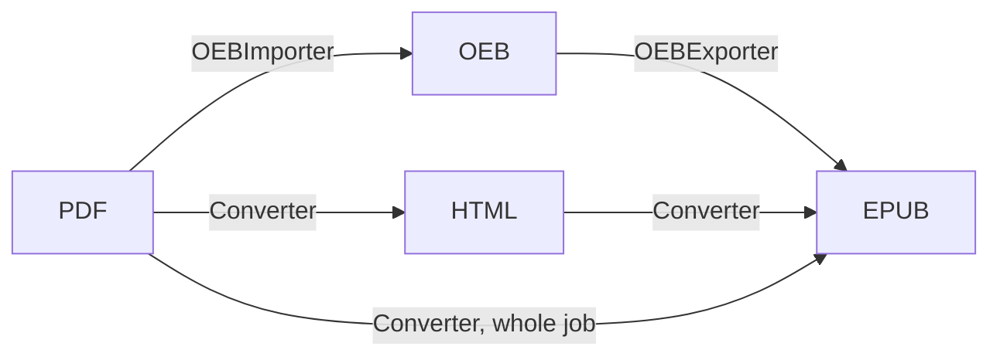

# Capability providers for file formats

Date: 2026-11-16

Status: **Proposal for review.** Build steps 1 and 2 are in draft pull
requests #171 and #172, the metadata capabilities in #173, and the metadata
reader pool in #175 to #177; nothing here is merged. The move to Python 3.14
is #174.
Source checkpoint: `main` at `2d2a9cc3`.

Revised on 2026-11-17: the maintainer accepted the recommendations on metadata
readings and claims, and then split metadata providers by model, calibre or
WEMI. [Readings and claims](#readings-and-claims) records both.

Revised later on 2026-11-16: the first draft overlooked the conversion edge
registry, the conversion report and the planned conversion tasks that already
exist. [What already exists](#what-already-exists) now records them, and the
proposal is reworded to extend them instead of introducing parallel concepts.

This briefing records an architecture discussion with the maintainer on
2026-11-16. It proposes replacing the inherited one-plugin-per-format model in
`file_formats` with typed capability providers, conversions built from
composable steps, and recorded provenance. Decisions the maintainer has made
are marked **decided**; the rest are proposals to accept, change or reject.

Code and SQL in this guide are sketches that show shape. Names, signatures and
columns are open to change in review.

## The short version

- Every kind of operation gets **one base class**. A plugin subclasses the
  capabilities it provides, and the registry keeps a typed list per capability.
- **Several providers** can serve the same capability and format. Settings
  choose the default; a run can override it; a fallback chain is allowed.
- A **conversion is a route through providers**, not a fixed pair of plugins.
  A provider can import to an intermediate, export from one, or do a whole
  format-to-format job, and routes can chain.
- **OEB and HTML are both intermediates.** More can be added by name.
- **Routes have names**, such as `pdf.compress`. A route may start and end in
  the same format, so compression, OCR and repair pipelines fit.
- **Transforms** between import and export are their own capability and run in
  fixed, named stages.
- Each run records **which provider ran on which file**. Everything a
  metadata source says is kept as a **reading**, and each value the catalogue
  accepts records **which reading it came from**.

## Why change

The format plugins still follow calibre's model. Three properties of it limit
what the project can do without dropping formats.

1. **One implementation per format.** `plugin_for_input_format`
   (`file_formats/plugin_runtime.py:756`) returns the first plugin whose
   `file_types` contains the extension. Two readers for one format cannot
   coexist as choices.
2. **Conversion runs as one fixed box.** `Plumber.run`
   (`file_formats/conversion/plumber.py:1549`) takes one input plugin and one
   output plugin and always goes through OEB. The edge registry can describe a
   whole-conversion tool or a direct edge, but nothing executes one.
3. **Nothing durable records what ran.** A `ConversionReport` holds the edge
   and any loss events in memory, but the conversion job does not return it
   and nothing is stored. An extracted author carries no record of the reader
   that produced it.

A fourth, shared state on plugin instances (`site_customization` is assigned
per call), belongs to execution and lifetime, which this proposal leaves to
[PL-02](next_tasks.md).

## What already exists

The project has already started on parts of this, and the proposal builds on
them.

| Existing piece | What it does today | How this proposal uses it |
| --- | --- | --- |
| `ConversionEdge` and `ConversionEdgeRegistry` (`file_formats/conversion/edges.py`) | Describe a conversion from one format to another, with a kind (`oeb`, `direct` or `external`), a priority, an `intermediate_format`, an external tool name and version, and a `lossless` flag. `Plumber` records the edge for the path it runs. The [pipeline guide](<../conversion_pipeline/00 - Conversion Pipeline.md>) notes it is not yet a planner that selects and executes. | An edge is the description of one route step. The capability bases are what executes it. |
| `ConversionReport` and `ConversionLossEvent` (`file_formats/conversion/report.py`) | Collect warnings and structured loss events for a conversion. PML, TXT, HTMLZ and comic code report through them. | The result of a route is a `ConversionReport`, extended to name the provider that ran each step. |
| `archive_preflight.py` | Bounds member count, size and compression ratio, and rejects unsafe member names, for six inputs. | Packed intermediates are read through it. |
| [CONV01](../conversion_pipeline/next_tasks.md) | Planned: carry the conversion report through jobs and Core, naming the selected provider and edge. | The same work as recording which provider ran. |
| [CONV02](../conversion_pipeline/next_tasks.md) | Planned: isolate each conversion's directory. | Part of the parked execution policy. |
| [CONV03](../conversion_pipeline/next_tasks.md) | Planned: give the edge registry one real consumer, with no empty planner abstraction. | The first `Converter` and the first named route are that consumer. The proving routes below follow the same rule. |

How the pieces line up:

- An `oeb` edge is an `OEBImporter`, the OEB transforms and an `OEBExporter`.
- A `direct` or `external` edge is a `Converter`.
- `intermediate_format` is `oeb` today and gains `html`.
- A named route is an ordered list of edges. The registry describes one edge
  per pair of formats now; routes extend that to sequences.

## Decisions so far

| Topic | Position | Status |
| --- | --- | --- |
| One base class per capability; a class may inherit several | Typing and the registry both stay simple | **Decided** |
| Several providers per capability and format | Default in settings, per-run override, fallback chain | **Decided** |
| Results record the provider that ran | Part of every result | **Decided** |
| Input and output providers chosen independently | Each with its own default settings | **Decided** |
| Whole-conversion providers and chains | First-class, alongside import and export | **Decided** |
| Intermediates | OEB and HTML to start; not OEB alone | **Decided** |
| Named routes | Every route has a name; a format pair's default points at one | **Decided** |
| Same-format routes (loop-backs) | Supported in all three forms | **Decided** |
| Output of a same-format route | Stays within the same Manifestation, recorded as derived; the original stays | **Decided** |
| Strict WEMI for derived files | No project-specific exceptions | **Decided** |
| Output of a format conversion | A derived Manifestation, linked to its source | **Decided** |
| Provenance of metadata claims | New tables: one for readings, one for accepted claims | **Decided** |
| How much of a read is recorded | The whole reading as one JSON document per read, plus a row for each value the catalogue accepts | **Decided** 2026-11-17 |
| Vocabulary of a reading | Depends on the model. A calibre reading uses calibre's field names and value shapes, and one mapping assigns each field to a WEMI level when a value is accepted. A WEMI reading is already placed by level. Each stored reading records its model | **Decided** 2026-11-17 |
| Metadata models | Two, calibre and WEMI, each with its own reader and writer classes under a family parent: `CalibreMetadataReader`, `WEMIMetadataReader`, `CalibreMetadataWriter`, `WEMIMetadataWriter`. Named for the model, not the project | **Decided** 2026-11-17 |
| Two models, same file | A WEMI reading outranks a calibre reading of the same file | **Decided** 2026-11-17 |
| Metadata reader pool | Keep the fork's readers and the LiuXin readers, and add current upstream calibre: ported where practical, through an installed calibre's `calibre-debug` otherwise | **Decided** 2026-11-17 |
| Model of the LiuXin readers | WEMI: each reader plugin as the application runs it, placed by level | **Decided** 2026-11-17 |
| Python version | The project moves to Python 3.14, which upstream calibre already requires | **Decided** 2026-11-17 |
| Who writes readings | Tables designed for file readers, online sources and manual edits; file readers wired first | **Decided** 2026-11-17 |
| Precedence between sources | A manual edit outranks an online source, which outranks the file | **Decided** 2026-11-17 |
| Keeping readings | Every reading is kept | **Decided** 2026-11-17 |
| Transforms | Own capability, run in fixed stages | **Decided**; how stages are added is still open |
| Capability names; `CoverExtractor` separate from the metadata readers | As listed below | **Decided** |
| Import and export classes | A separate class per intermediate | **Decided** |
| OCR output | A separate Item of the same Manifestation | **Decided** |
| Route names | Free-form | **Decided** |
| Transform classes | One per intermediate: `OEBTransform`, `HTMLTransform` | **Decided** |
| HTML intermediate | Defined as a concrete type, also usable to represent HTML documents, carrying page titles and a table of contents | **Decided**; the [specification](../file_formats/html-book-spec.md) is a draft for review |
| Intermediates on disk | Each has a saved form with load and save; an intermediate is a valid start or end of a route | **Decided** |
| calibre's newer transforms | Supported: port them into the stages | **Decided** |
| Execution policy (in-process, worker, limits) | Decide after the architecture, possibly per plugin | **Parked** |

## Capabilities

Each capability is one abstract base class with one typed entry point.

| Base class | Turns | Replaces today |
| --- | --- | --- |
| `CalibreMetadataReader`, `WEMIMetadataReader` | a file into a metadata reading in that model | `MetadataReaderPlugin` |
| `CalibreMetadataWriter`, `WEMIMetadataWriter` | metadata in that model into a file | `MetadataWriterPlugin` |
| `CoverExtractor` | a file into a cover image | cover logic inside readers |
| `OEBImporter`, `HTMLImporter` | a format into that intermediate | `InputFormatPlugin` |
| `OEBExporter`, `HTMLExporter` | that intermediate into a format | `OutputFormatPlugin` |
| `Converter` | a format into a format, the whole job | nothing executes one; `direct` and `external` edges describe it |
| `OEBTransform`, `HTMLTransform` | that intermediate into itself | calls inside `Plumber.run` and output plugins |

Import, export and transform have a separate class per intermediate, so a
provider's base class states exactly what it produces or consumes. `Importer`,
`Exporter` and `Transform` remain as abstract parents that carry the shared
record and are never subclassed directly by a provider. Adding an intermediate
means adding its three classes.

An exporter also declares the package-stage transforms it needs, as a class
attribute, so the pipeline runs them instead of the exporter calling them.

More capabilities can be added when a real operation does not fit, for example
text extraction for search or validation.

```python
class Provider(ABC):
    """Common record every provider carries as class attributes."""

    provider_id: ClassVar[str]          # stable, for example "pdf.reader.builtin"
    version: ClassVar[str]
    licence: ClassVar[str]
    priority: ClassVar[int] = 0         # higher is preferred
    requires: ClassVar[tuple[str, ...]] = ()   # extras or external tools


class MetadataReader(Provider):
    """Family parent; providers subclass the class for their model."""


class CalibreMetadataReader(MetadataReader):
    calibre_read_formats: ClassVar[frozenset[str]]

    @abstractmethod
    def read_calibre_metadata(
        self, source: Path, source_format: str, context: ProviderContext
    ) -> CalibreFields: ...   # calibre names and shapes, as JSON values


class WEMIMetadataReader(MetadataReader):
    wemi_read_formats: ClassVar[frozenset[str]]

    @abstractmethod
    def read_wemi_metadata(
        self, source: Path, source_format: str, context: ProviderContext
    ) -> WEMIFields: ...      # values placed at work, expression, ...


class Importer(Provider):
    """Family parent; providers subclass one of the classes below."""


class OEBImporter(Importer):
    oeb_source_formats: ClassVar[frozenset[str]]

    @abstractmethod
    def import_oeb(
        self, source: Path, source_format: str, context: ProviderContext
    ) -> OEBBook: ...


class HTMLImporter(Importer):
    html_source_formats: ClassVar[frozenset[str]]

    @abstractmethod
    def import_html(
        self, source: Path, source_format: str, context: ProviderContext
    ) -> HTMLBook: ...


class Converter(Provider):
    conversions: ClassVar[frozenset[tuple[str, str]]]   # explicit pairs

    @abstractmethod
    def convert(
        self,
        source: Path,
        source_format: str,
        target: Path,
        target_format: str,
        context: ProviderContext,
    ) -> None: ...
```

Each capability uses its own attribute and method names (`oeb_source_formats`
and `import_oeb`, `html_target_formats` and `export_html`, and so on), so a
class that inherits several never has two members with the same name.
`ProviderContext` carries the call's options, log, report and work folder.
The full set is in `file_formats/providers/` on the build-step pull requests.

One class can provide several capabilities by inheriting several bases. The
registry files it under each. A provider that needs something missing reports
itself unavailable with the reason, which is the outcome
[PL-01](next_tasks.md) asks for.

## Intermediates

An intermediate is a book held in a form that providers pass between them. Two
are defined to start. Each has an in-memory type and a saved form on disk, with
one function to load it and one to save it.

| Intermediate | In memory | Saved form | Code that already does this |
| --- | --- | --- | --- |
| OEB | `OEBBook` (`file_formats/oeb/base.py`) | A folder holding an OPF file and the book's files | `oeb_output.py` writes it; HTML input reads an `opf` |
| HTML | `HTMLBook`, proposed below | A folder holding an entry page and its resources, or that folder as a ZIP | `html_input.py` reads the folder; `html_output.py` writes the ZIP; `Plumber.unarchive` reads it |

Because every intermediate can be saved and loaded, it is also a valid place
for a route to start or end. A route may stop at OEB and leave the folder as
its result, which the inherited "OEB Output" plugin already does today, and a
file-based `Converter` can hand its output to an exporter:

- a `Converter` produces or consumes **files**;
- an importer, exporter or transform produces or consumes the **in-memory**
  form;
- where a route joins the two, the runner loads or saves the intermediate.
  Providers never do this themselves.

### The HTML intermediate

`HTMLBook` describes a set of HTML pages and their resources in one folder.
The [HTMLBook specification](../file_formats/html-book-spec.md) is the full
definition; this is a summary.

- It holds a root folder, an entry page, the pages in reading order (each with
  its encoding and title), the resources, a table of contents, and an optional
  cover and metadata sidecar.
- It describes a folder and never changes it. An `HTMLTransform` writes a new
  folder and returns a new `HTMLBook`.
- Every path is relative to the root and must resolve inside it.
- Its saved forms are a folder and a ZIP. HTMLZ is a narrower profile holding
  a single page.
- `OEBBook` is parsed content held in memory; `HTMLBook` is a description of
  files on disk. A file-based `Converter` can therefore use its folder
  directly.
- The same type can describe an HTML document the library holds, for example
  a page acquired by web ingest. The storage schema's composite assets are a
  natural home for one; that is a suggestion for the
  [storage](../storage_and_backup/README.md) owner, not a decided design.

## Registration

Subclassing a capability base class is what makes a provider. The record is
the class attributes above, so there is no separate manifest to keep in step.

- **Bundled providers** are listed by module in one table, as
  `file_formats.plugin_defaults` does today. Modules must stay cheap to import
  and load heavy dependencies inside methods, which is already this package's
  habit.
- **Third-party providers** register through a Python entry-point group, in
  addition to the existing ZIP loader.
- The registry answers typed queries, for example every
  `CalibreMetadataReader` for `pdf`, in selection order.

## Selection

For a capability and format the registry may hold several providers.

1. A **per-run override** names the provider to use.
2. Otherwise **settings** name the default.
3. Otherwise the highest **priority** available provider is used.
4. A configured **fallback chain** is tried in order when a provider fails.

The result always states which provider ran and which were tried first.

## Conversion as a route

Treat every format and every intermediate as a node, and every conversion
provider as an edge between two nodes. This is the graph that
`conversion/edges.py` already models; what is added is a provider that
executes each edge, and routes made of more than one edge.



calibre's pipeline is one route in this picture: an `OEBImporter` in, then
an `OEBExporter` out. A `Converter` is a direct edge. A chain is a longer route.
Choosing the input and output providers independently means choosing the edge
used at each step.

Rules that keep this manageable:

- **Intermediates are a short named list.** OEB and HTML to start. A provider
  cannot introduce one silently, so the data passed along each edge has a
  known type.
- **Routes are named and curated before they are searched.** A route is an
  ordered list of providers with a name, for example `pdf.to-epub.via-html`.
  Settings map each pair of formats to its default route. Automatic
  route-finding is a fallback, limited to short routes, and the plan is shown
  before it runs.
- **Metadata is not a provider's job to carry.** It is read once from the
  source. On a leg that passes through OEB it is merged into the book at the
  `structure` stage, as `MergeMetadata` does today. On a route made only of
  `Converter` steps it is written to the result at the end by a metadata
  writer. No provider in the middle has to preserve it.

Edges already carry a `lossless` flag. Later, each edge should declare what
it preserves (structure, images, fixed layout) so that a fallback does not
choose a lossy hop. That can wait until there are competing routes to choose
between.

### Same-format routes

A route may end in the format it started from. Compression, OCR, repair and
similar pipelines are routes of this kind, and all three forms are supported:

| Form | Example |
| --- | --- |
| A `Converter` whose source and target are the same format | A PDF compressor: PDF to PDF |
| A round trip through an intermediate | EPUB to OEB, `resources`-stage transforms such as image rescaling and font subsetting, then OEB to EPUB |
| A chain out and back | PDF to page images, then images to PDF |

Two formats no longer identify what is wanted, since PDF to PDF could mean
compress, OCR or repair. That is why routes carry names: the request is for
`pdf.compress`, not for a pair of formats.

Rules:

- **The planner never loops by itself.** Automatic route-finding skips
  same-format edges and never revisits a format. A same-format route runs only
  when it is requested by name.
- **The result is a new file, never a replacement.** The original stays, in
  line with the project's preservation principles.
- **The new file belongs to the same Manifestation** and is recorded as
  derived from the original through `digital_asset_derivations`. The schema's
  comments already list derivation kinds such as `repacked` and `repaired`.

Whether the result is a new Asset or a new Item follows the policy in the
next section.

## Where derived files sit in WEMI

The maintainer's decision is to follow WEMI strictly, with no project-specific
exceptions. Format is a Manifestation attribute, both in WEMI and in this
schema, whose guide describes a Manifestation as carrying edition and format.
An EPUB and a MOBI of one book are therefore different Manifestations, and a
local conversion creates one.

The level of a new record is decided by what changed:

| What happened | New record | Example | Status |
| --- | --- | --- | --- |
| Same bytes, another place | Replica | A backup copy | Existing behaviour |
| Different bytes, same content and format | Asset on the same Item | Lossless recompression, repack, repair, rewritten metadata | Proposed |
| Content changed, same format | Item of the same Manifestation | OCR text added | **Decided** for OCR |
| Content changed, same format | Item of the same Manifestation | Lossy compression that reduces image quality | Proposed |
| Format changed | Manifestation, marked as derived and linked to its source | A local EPUB to MOBI conversion | **Decided** |

Two rules stop the catalogue filling with records:

- **An Item is created only by acquiring a copy or by a derivation that changes
  content.** Copying and lossless re-encoding never create one.
- **A derived Manifestation is marked as derived** and linked to the
  Manifestation it was made from, so it never reads as something a publisher
  issued. Their number is bounded by formats, not by files.

What a conversion writes, in one transaction owned by Catalog:

1. a derived Manifestation under the same Expression;
2. a link from it to the source Manifestation;
3. an Item for the new copy;
4. the new Asset, with a derivation edge to the source Asset and the run that
   made it.

### Consequence for calibre import

The same policy gives the calibre import its default shape, as the maintainer
noted: one calibre book becomes one Work and one Expression, and **each format
file becomes a Manifestation of that Expression**, with its own Item and
Asset. This may be wrong for individual books, and is acceptable as an import
default that can be corrected afterwards.

Points for the import design, which belongs with the
[calibre mapping guide](<../calibre_compat/mapping calibre to LiuXin.md>):

- calibre does not record whether a format was acquired or converted, so
  imported Manifestations are not marked as derived. Their origin is the
  import.
- calibre keeps the pre-conversion file as an `ORIGINAL_<FORMAT>` entry when it
  converts or polishes a book in place. Such a pair is the same format, so it
  belongs to one Manifestation, with the plain entry derived from the
  original.
- Two formats of one calibre book can be different editions. Splitting them
  into separate Expressions is a later, manual correction.
- The rationale text for manifestation links in `intralink_table_requests.toml`
  used to say only that everything is assumed to be under one Manifestation.
  It now states that this matching default applies within one edition and
  format, and that different formats are separate Manifestations. The text is
  documentation; the generator does not read it.

The schema already has manifestation-to-manifestation links
(`intralink_table_requests.toml`), with one type, `user_marked_different`.
A `derived_from` type would be an addition to that declaration. Items have no
field marking a copy as locally made; the per-copy provenance columns in
`4-items.sql` are the place to look first.

## Transforms and stages

An `OEBTransform` or `HTMLTransform` takes its intermediate and returns the
same kind. Transforms are
not routing choices, so they are not edges: a route decides how to get from
one format to another, and transforms decide what happens to the book on the
way.

The order is fixed by **stage**, not by one list in the core. The core defines
a small set of named stages per intermediate, in a fixed order. Each transform
declares its stage and a priority within it. A later plugin can then join an
existing stage without editing the core, and runs stay deterministic. The
result lists the transforms applied, in order.

### Stages for OEB

These six stages are read from the current code. Stages 1 to 5 are the order
`Plumber.run` already uses, so adopting them changes no behaviour.

| Stage | Purpose | In LiuXin today | In calibre 9.18, to port |
| --- | --- | --- | --- |
| 1 `normalise` | Make the book consistent after import | `Clean` (guide); each input plugin's `postprocess_book` and `specialize` | `DataURL` |
| 2 `structure` | Establish what the book is and how it is organised | `MergeMetadata`, `DetectStructure`, `Jacket` | `RemoveFirstImage` |
| 3 `content` | Rewrite text and markup | `LinearizeTables`, `UnsmartenPunctuation` | `AddAltText` |
| 4 `style` | Resolve CSS for the target | `CSSFlattener`, `RemoveFakeMargins`, `RemoveAdobeMargins` | |
| 5 `resources` | Settle fonts, images and the manifest | `EmbedFonts`, `SubsetFonts`, `ManifestTrimmer` | |
| 6 `package` | Shape the book for one output format | `Split`, `CaseMangler`, `HTMLTOCAdder`, `UniqueFilenames`, `FlatFilenames`, `CoverManager` | |

The three calibre transforms in the last column do not exist in this fork.
The maintainer wants calibre's newer work supported, so they are part of the
plan. calibre's code is GPL v3, the same licence as this project, so they can
be ported with their upstream notices.

### What the current code forces the design to handle

- **Stage 6 is hidden inside the output plugins.** Each output plugin calls
  `Split`, `CaseMangler` and the others itself; `Split` is called from four of
  them. An `Exporter` should instead declare which package transforms it
  needs, and the pipeline should run them. `RescaleImages` and `SVGRasterizer`
  are also called from output plugins and belong in `resources`.
- **Conditions are scattered.** Whether a transform runs is decided by tests on
  options and on the output format inside `Plumber.run`. Each `Transform`
  should carry its own applicability test.
- **One transform is coupled to the exporter.** `CSSFlattener` receives a
  callback from the output plugin (`specialize_css_for_output`). That needs a
  defined hook.
- **Order inside a stage can matter.** `MergeMetadata` must precede `Jacket`,
  which builds a page from the metadata. Priority covers it. An explicit
  "after" rule should be added only when priority stops being enough.

### Stages for HTML

HTML has one transform-like step today, the `HTMLPreProcessor` clean-up. Give
`HTMLTransform` a single `normalise` stage and add others when something needs
them.

### Adding stages later

Still under discussion. The aim is room to grow without building machinery
nobody uses. Three options, from least to most flexible:

| Option | How a stage is added | Trade-off |
| --- | --- | --- |
| A. Closed list | The stage list is one tuple per intermediate in the core; adding a stage is a reviewed core change | Simplest and fully predictable; a plugin cannot add a stage |
| B. Closed list with slots | As A, and a transform also declares `early`, `normal` or `late` within its stage | Eighteen positions from six names, with no new concept for plugin authors |
| C. Plugin-declared stages | A plugin registers a stage anchored before or after an existing one | Most flexible; two plugins can disagree about order, and the pipeline is harder to explain |

Recommended: start with A, add B when a transform first needs to run before or
after its stage-mates, and adopt C only if a real plugin cannot be expressed
with B.

### Costs

- Stage names become a contract once plugins rely on them. Start with these six
  and add a stage only when a real transform does not fit.
- Moving the package transforms out of the output plugins is the largest piece
  of migration work in this proposal.

## Provenance

### What exists

The schema already models runs on files:

- `transform_runs`: type, tool, profile, parameters, parameter hash, actor,
  status, error and timings.
- `transform_run_inputs` and `transform_run_outputs`: the digital assets a run
  read and wrote.
- `digital_asset_derivations`: parent-to-child edges, with an optional run.

A conversion step fits these tables. A chain is several runs joined by
derivation edges. Outside the schema these tables are referenced only in
column metadata and one web surface, so no conversion code appears to write to
them yet. `transform_run_tool` is free text; a provider id and version would
be better as their own columns.

### What is missing

Nothing records where a metadata value came from. Identifiers have a free-text
`entity_identifier_provenance` column; links such as work-to-creator carry no
source. The question "which plugin run, on which file, said this PDF has this
author" cannot be answered.

### Readings and claims

A **reading** is everything one source said about a book at one time: a
metadata reader's output for one file, the result of one online lookup, or one
manual edit. A **claim** is one value from a reading that the catalogue
accepted. A **catalogue fact** is what the library currently holds to be true.
Keeping the three apart is what lets these questions be answered:

- Why does the catalogue say this? Follow the fact to its claim, and the claim
  to its reading.
- A reader had a bug. Which facts rest only on claims from that provider and
  version?
- The file, an online source and a person disagree. What did each say?
- A better reader exists now. What would change if it were used?

The maintainer decided the following on 2026-11-17. In code, a calibre reader
returns `CalibreFields` and a WEMI reader returns `WEMIFields`; the stored
document is the `to_document()` output of either.

1. **The whole reading is kept, and accepted values get rows.** Each read
   stores one JSON document holding every field and value the source gave.
   Each value the catalogue accepts gets one claim row that points at the
   reading and at the fact it supports. Rejected values stay in the document,
   so re-deciding never means reading the file again, which matters when the
   file is offline or on tape. The cost is one row per read, rather than ten
   to twenty.
2. **There are two metadata models, each with its own classes.**
   - A **calibre** reading uses calibre's field names and value shapes:
     authors as a list of names, identifiers as a mapping of scheme to
     value, dates as ISO 8601 text. Most existing readers produce calibre
     metadata, so they do not have to be rewritten. One mapping, kept in
     code, decides which WEMI level and table each field lands on when a
     value is accepted: for example authors to the Work and publisher to
     the Manifestation. The full mapping is drafted with the reader
     adapters.
   - A **WEMI** reading is already placed at the Work, Expression,
     Manifestation or Item it describes, with creators by role and
     identifiers by scheme at the right level. It needs no mapping. No
     reader produces one yet; the field names within each level are fixed
     with the first WEMI reader, following the WEMI metadata bundles.

   Readers and writers are separate classes per model, under the family
   parents `MetadataReader` and `MetadataWriter`: `CalibreMetadataReader`,
   `WEMIMetadataReader`, `CalibreMetadataWriter` and `WEMIMetadataWriter`.
   The classes are named for the model, not the project. Every reading is
   recorded against the file it came from, together with its model.
3. **The tables serve all three sources; file readers come first.** File
   readers, online sources and manual edits all produce readings. File
   readers are wired first. Until the other two are, a fact with no claim
   means "origin not recorded"; it does not mean "came from a file".
4. **A manual edit outranks an online source, which outranks the file.** A
   reading that disagrees with a fact held by a higher-ranked claim is kept,
   and the fact does not change. A re-read therefore never overwrites a
   person's correction. **Within the file rank, a WEMI reading outranks a
   calibre reading of the same file**, because it is the richer source; the
   registry lists WEMI readers before calibre readers for this reason.
5. **Every reading is kept.** Reading a file again adds a reading; it does not
   replace the earlier one. A claim that a higher-ranked one replaces is
   marked as superseded, not deleted.

A metadata read is a run with an input asset and no output asset, so it can
reuse `transform_runs`. An online lookup is a run with no input asset. A
manual edit is not a run; its reading names the person instead.

```sql
-- One row per reading: everything one source said, kept whole.
CREATE TABLE metadata_readings (
  metadata_reading_id               INTEGER PRIMARY KEY,
  metadata_reading_source_kind      TEXT NOT NULL,  -- 'file', 'online', 'manual'
  metadata_reading_model            TEXT NOT NULL,  -- 'calibre' or 'wemi'
  metadata_reading_run_id           INTEGER,        -- transform_runs; file and online
  metadata_reading_digital_asset_id INTEGER,        -- the file read; file only
  metadata_reading_source           TEXT NOT NULL,  -- provider id and version, service, or person
  metadata_reading_document         TEXT NOT NULL,  -- JSON: every field and value given
  metadata_reading_recorded_at      TEXT NOT NULL
);

-- One row per catalogue fact a reading supports.
CREATE TABLE metadata_claims (
  metadata_claim_id            INTEGER PRIMARY KEY,
  metadata_claim_reading_id    INTEGER NOT NULL,  -- metadata_readings
  metadata_claim_field         TEXT NOT NULL,     -- field as in the reading; level-qualified for WEMI
  metadata_claim_value         TEXT NOT NULL,     -- JSON
  metadata_claim_target_table  TEXT NOT NULL,     -- where the fact is stored
  metadata_claim_target_row_id INTEGER NOT NULL,
  metadata_claim_accepted_at   TEXT NOT NULL,
  metadata_claim_superseded_at TEXT               -- set when a higher-ranked claim replaces it
);
```

One accepted value can support several facts. An authors field naming two
people becomes two creator links, so it gets two claim rows.

Still open: which claim wins between two readings of the same rank **and**
the same model, for example two calibre readers of one file, or two files of
the same Work that disagree. The proposal is that the newer accepted reading
wins, but this has not been reviewed.

#### Three kinds of metadata object in today's code

Splitting by model came from what the existing readers return. The code holds
three kinds of metadata object, not two:

| Object | Shape | Produced by |
| --- | --- | --- |
| calibre's `Metadata` (`metadata/book/base.py`) | calibre's own | Most format readers, natively |
| `CalibreLikeLiuXinBookMetaData` | calibre's interface over LiuXin internals: creators by role in ordered dictionaries, placeholder entries such as `{None: None}` | The EPUB and LRF reader plugins, which ask for it, and the PDF, PML and HTMLZ/TXTZ readers, through `finalize()` |
| `LiuXinWEMIMetadata` | Four WEMI bundles with identities, relation links and provenance | The catalogue, when it loads a book; no file reader |

The middle object is a migration midpoint, not a model, and no provider
returns it. Running the plugins on sample files showed that most of them
return it today: EPUB, LRF, HTML, RTF, FB2, HTMLZ, TXTZ, PML, PDF and IMP. TXT,
OPF, MOBI, LIT, LRX, RB, SNB, Topaz, comic and ODT return calibre's
`Metadata`, and ZIP and RAR return whatever the book inside produces.
Existing callers of the middle object keep using it until they move.

#### The metadata reader pool

On 2026-11-17 the maintainer decided to keep both existing sets of readers
and to add current upstream calibre, giving a pool to compare. Each set is a
group of providers; all of them also extract covers.

| Set | Provider ids | Model | What runs | Priority |
| --- | --- | --- | --- | --- |
| LiuXin | `liuxin.read-…` (25) | WEMI | Each reader plugin as the application runs it. The middle object is placed by level from its own calibre conversion, with its creators by role and its identifier lists laid over, because that conversion drops them | −100 |
| Upstream, ported | `calibre-port.read-…` (TXT, IMP, RB and LRX so far) | calibre | calibre 9.18's reader modules, copied with only their imports changed, in process | −50 |
| Upstream, installed | `calibre.read-…` (25) | calibre | calibre's own reader plugin inside the user's installed calibre, through `calibre-debug`; unavailable where calibre is not installed | −60 |
| Fork | `fork.read-…` (12) | calibre | The fork's calibre path: the plugins that return calibre's `Metadata`, and EPUB and LRF with their calibre switches on | −100 |

For one format the registry lists WEMI readers first, because a WEMI reading
outranks a calibre reading of the same file, and then calibre readers by
priority: port, installed calibre, fork. All calibre readings are serialised
the same way, with calibre's `metadata_as_dict`, dates as ISO 8601 text and
anything without a JSON form kept as text and reported, so the sets compare
like for like.

The LiuXin readers use a **provisional** calibre-to-WEMI mapping in
`file_formats/providers/wemi_mapping.py`, which is also the mapping for
accepting calibre readings:

- **Work:** titles, title sort, author sort, series with its index, subjects
  (calibre's tags), and creators in the authors and composers roles.
- **Expression:** languages, description (calibre's comments), and creators
  in the editor, translator, illustrator, artist, colourist and director
  roles; a role the mapping does not know also goes here.
- **Manifestation:** publishers, publication date, identifiers, rights, and
  creators in the producer, book-producer and cover-artist roles.
- **Any other field** is kept under `unplaced` at the Manifestation, so no
  reading loses what its source said.

Porting continues reader by reader, cheapest first. SNB, RTF, Topaz and PML
each need one more calibre subsystem; ZIP and RAR need calibre's reader
dispatch; EPUB, MOBI, FB2, PDF and ODT need OPF, XMP or MOBI internals and are
projects of their own. Until a reader is ported, the installed-calibre
provider covers its format wherever calibre is installed.

The pool's first comparisons already found differences: the fork's EPUB
calibre path and the LiuXin EPUB and HTMLZ readers drop publisher, language
and subjects that the files carry, and the fork's TXT reader no longer splits
authors on commas as upstream does.

Writing claims for manual edits touches every catalogue write path and the
[catalog write contract](../catalog/catalog-write-validation-contract.md).
That is why manual edits and online sources are wired after file readers.

The schema change belongs to the
[databases](../databases/README.md) and [catalog](../catalog/README.md)
owners; the sketch above is input to them, not a finished design.

## Compatibility and migration

- **Existing plugins keep working through an adapter.** `InputFormatPlugin`
  becomes an `OEBImporter`, `OutputFormatPlugin` an `OEBExporter`,
  and the metadata plugins their matching capabilities. Nothing is rewritten
  up front, and formats move to native providers one at a time.
- **Third-party calibre plugins** are not promised to load unchanged, as the
  [calibre compatibility guide](<../05 - Calibre compat.md>) already says.
- **Existing follow-ups still apply.** Availability reporting is
  [PL-01](next_tasks.md), instance and registry lifetime is PL-02, and keeping
  standalone formats independent of the application is PL-04.

## Proposed build order

| Step | Work | Done when |
| --- | --- | --- |
| 1 | Capability base classes and a typed registry | The registry returns typed providers for a capability and format, with tests |
| 2 | Adapter for today's plugins | Every bundled plugin is reachable through the registry and existing conversions give the same output |
| 3 | Selection: settings default, per-run override, fallback; the report names the provider (CONV01) | Two providers for one format can be chosen between, and the result names the one that ran |
| 4 | `Converter` capability on one real direct or external edge (CONV03), the `HTMLBook` type with load and save, named routes and route planning | A two-hop route and a same-format route each run by name and are recorded; automatic planning never selects a same-format edge |
| 5 | `Transform` capability and stages, including the three calibre transforms | `Plumber.run` contains no direct transform calls, and output plugins declare their package transforms |
| 6 | Provenance: runs written for conversions; readings and claims tables | The run and file behind a stored author can be queried |

Steps 1 to 3 change no conversion behaviour. Step 5 is the largest.

### Proving the bases before freezing names

Three routes exercise every base and every join between them. If all three
run without a special case, the bases are right:

1. a round trip: EPUB to OEB and back to EPUB;
2. a chain through HTML: a file-based `Converter` produces HTML, and an
   `HTMLExporter` or a second `Converter` produces the final format;
3. a single `Converter` wrapping one external tool.

## Parked

- **Execution policy.** In-process or worker, resource limits and isolation.
  It may differ per plugin and may need more base classes.
- **Typed options.** Replacing `OptionRecommendation` sets with a validated
  schema per provider, stored as JSON.
- **Richer loss declarations.** Edges already carry a `lossless` flag and
  reports already carry loss events. Declaring what each edge preserves
  (structure, images, fixed layout) is later work.

## Questions for review

Answered on 2026-11-16 and folded into the text above: capability names, a
separate class per intermediate, transforms as a staged capability, OCR output
as a separate Item, and free-form route names. Answered on 2026-11-17: how
much of a read is recorded, the vocabulary of readings, who writes readings,
precedence between sources, keeping every reading, separate calibre and WEMI
metadata classes, and WEMI over calibre for the same file (see
[Readings and claims](#readings-and-claims)).

Still open:

1. How are stages added later: option A, B or C under
   [Adding stages later](#adding-stages-later)?
2. Is the split for compression right: a lossless result is a new Asset on the
   same Item, and a lossy result is a new Item?
3. Between two readings of the same rank and model, which claim wins? See
   the end of [Readings and claims](#readings-and-claims).

Return to the [plugins index](README.md).
